2026년 11월 21일(토) 서울에서 열린 [PyTorch Day Korea 2026](https://pytorchday.kr/)에 다녀왔다.

최근 AI 논문들을 공부하고 있기 때문에, 그와 관련된 인사이트를 얻을 수 있을까 싶어 참여해보았다.

세션은 세 트랙으로 나뉘어 동시에 진행됐다. 나는 오후 세션에만 참여하였고 거기서 들은 내용들을 정리해 본다.

> 글에 들어간 이미지들은 발표 자료가 아니라, 정리한 내용을 바탕으로 AI와 함께 만든 것이다.

| 시간  | 세션                                                                                           |
| ----- | ---------------------------------------------------------------------------------------------- |
| 14:00 | PyTorch로 만드는 로컬 추론 엔진                                                                |
| 14:50 | 작은 모델을 더 작고 빠르게: Unsloth LoRA·TorchAO INT4 QAT부터 vLLM 서빙까지                    |
| 15:40 | The Search It Never Made: When a 1.2B On-Device Model Should Call Web Search                   |
| 16:25 | Ray 기반 엣지 환경에서의 고성능 LLM 서빙 제공하기: KV-Aware 라우팅 딜레마 해결과 오픈소스 기여 |
| 17:10 | 모델을 학습하며 마주한 메모리 병목과 최적화: Cross-Entropy부터 MoE 커널까지                    |

개인적으로 서빙 보다는 학습 이야기가 듣고 싶었던지라 5번 세션이 가장 재미있었다.

## 1. PyTorch로 만드는 로컬 추론 엔진

1번 세션은 사실 학습부터 시작되는지 알았는데 그렇지는 않았다.

공개된 Qwen3 가중치와 기본 PyTorch 연산만으로 Ollama 와 같은 추론 엔진을 처음부터 만들어 보는 발표였다. 최신 기법이 아니라 기본기를 판다는 점을 처음부터 분명히 했다.

상황 설정은 "회의록 요약 앱을 로컬로 만든다"였다.

### 첫 토큰이 만들어지기까지

모델은 Qwen3 0.6B다. 파일 크기 약 1.5GB, 텐서 311개, 파라미터 약 7.5억 개다. 토큰을 뽑는다는 건 결국 이 가중치를 어떤 순서로 곱하느냐의 문제라고 정리했다.

1. 메시지(list of dict)에 chat template을 적용해 텍스트로 편다. 이때 사용자 요청과 thinking 구간의 경계를 표시하는 special token이 들어간다.
2. 토크나이저로 숫자열로 바꾼다. 예시 회의록은 638토큰이었고 텐서 크기는 `(1, 638)`이다.
3. 임베딩 레이어를 통과시켜 `(1, 638, 1024)`로 만든다.
4. 트랜스포머 블록 28개를 통과시킨다. attention은 앞선 토큰 중 누구를 참고할지를, MLP는 그 관계를 바탕으로 한 연산을 맡는다. 크기는 그대로 유지된다.
5. 마지막 위치의 hidden state를 LM head에 통과시켜 다음 토큰 점수를 얻고 softmax로 확률을 만든다.

예시에서는 `1`이 약 60%로 1위였고 불릿 포인트가 2위였다. 요약을 번호로 시작할지 불릿으로 시작할지를 모델이 저울질한 흔적이다.

여기까지 걸린 시간은 Ollama 155ms, 직접 짠 코드 238ms였다. 첫 토큰만 보면 큰 차이가 아니다.

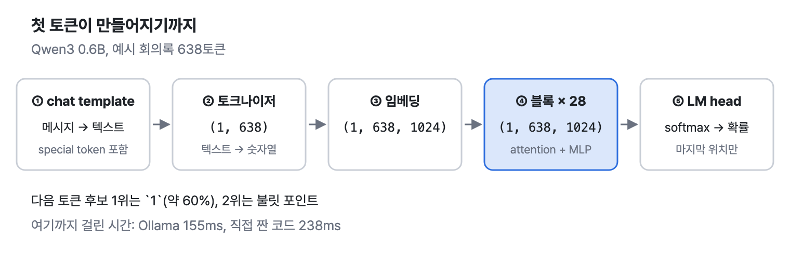

### 그대로 반복하면 3.6 TPS

추론은 이 과정을 EOS 토큰이 나올 때까지 반복하는 것뿐이다. 그런데 그대로 돌리면 **3.6 TPS**가 나온다. Ollama와 24배 차이다. 이후 발표는 이 차이를 하나씩 메워 가는 내용이었다.

| 단계            | 한 일                                                         | 결과                       |
| --------------- | ------------------------------------------------------------- | -------------------------- |
| naive loop      | 매 스텝 전체 시퀀스를 다시 forward                            | 3.6 TPS                    |
| KV cache        | 이전 토큰의 K, V를 저장하고 새 토큰만 계산                    | 37.9 TPS                   |
| SDPA            | 손으로 짠 attention을 `scaled_dot_product_attention`으로 교체 | attention 3.9ms → 1.5ms    |
| static cache    | `torch.cat` 대신 미리 할당한 버퍼에 `index_copy`              | (compile을 위한 준비)      |
| `torch.compile` | 연산을 합치고 CPU 디스패치를 줄임                             | 디코드 스텝 22ms → 14~15ms |
| int8 양자화     | 읽어야 할 가중치 크기를 절반으로                              | **92 TPS**                 |

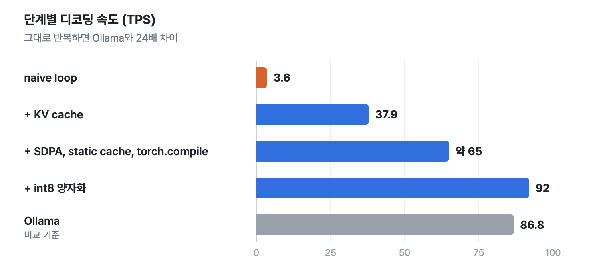

### KV cache

입력 길이별로 forward 시간을 재 보니 길이에 비례해 느려졌다. 638토큰으로 forward하고 다음엔 639토큰으로 또 forward하니 당연한 결과다.

새 토큰이 들어오면 그 토큰과 앞선 토큰들의 관계만 계산하면 되는데 이미 계산한 앞부분을 매번 다시 계산하고 있었다. 필요한 계산이 685번이라면 실제로는 3만 번을 하고 있었다고 한다. 그래서 attention에 쓰는 K, V를 저장해 두고 새 토큰 것만 추가로 계산한다. 구현은 `torch.cat`으로 이전 캐시에 새 K, V를 이어 붙이는 방식이었다.

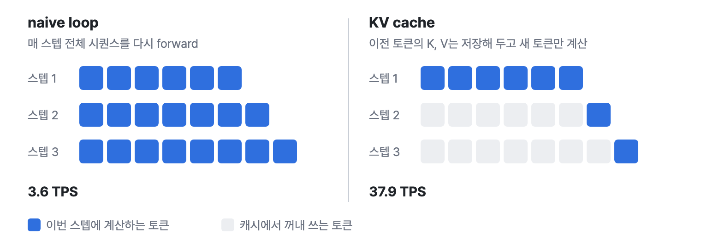

이것만으로 3.6 → 37.9 TPS로 10배가 올랐다. 다만 첫 토큰까지의 시간은 변하지 않는다.

비용은 메모리다. 638토큰 기준 약 74MB라 부담이 없지만 Qwen3의 최대 길이인 40K까지 가면 4.7GB쯤 된다. 요즘 KV cache 관리 이야기가 많이 나오는 이유다.

### SDPA — 커널 수를 줄인다

손으로 짠 attention은 `repeat_interleave`를 써서 다섯 줄 정도로 구현했는데 이를 PyTorch의 `scaled_dot_product_attention`으로 바꿨다.

둘의 차이는 계산을 몇 조각으로 나눠 실행하느냐다. 손으로 짠 쪽은 `repeat_interleave`로 K, V를 복사해 Q와 헤드 수를 맞춘 다음 행렬곱, 스케일링, 마스킹, softmax, 다시 행렬곱을 각각 별도 연산으로 실행하고, 그때마다 중간 텐서를 메모리에 쓴다. `scaled_dot_product_attention`은 같은 수식인 `softmax(QKᵀ/√d + mask)V`를 함수 호출 하나로 넘겨서 PyTorch 내부의 최적화된 구현이 이 과정을 묶어 처리한다.

빨라지는 이유는 커널 수다. 여기서 커널은 운영체제의 커널이 아니라 GPU에서 실행되는 함수 하나를 가리킨다. 행렬곱이나 softmax 같은 텐서 연산을 호출하면 PyTorch가 그에 해당하는 커널을 GPU에 올려 실행한다. 연산 하나는 GPU 커널 하나에 대응하고 커널마다 입력을 읽고 결과를 메모리에 다시 쓴다. 손으로 짠 attention은 커널 11개, SDPA는 2개였다. 메모리 접근이 그만큼 줄어든다. 회의록 길이에서 attention이 3.9ms → 1.5ms로 2.6배 빨라졌고, 디코드 한 스텝의 전체 연산 수도 3,190개에서 2,500개 수준으로 줄었다.

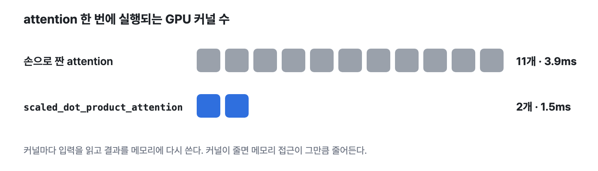

### static cache와 torch.compile

`torch.compile`이 잘 동작하려면 텐서 크기가 일정해야 한다. 그런데 `torch.cat` 방식의 KV cache는 매 스텝 모양이 바뀌고, 이어 붙일 때마다 통째로 복사까지 한다.

그래서 KV cache를 1,024토큰분(117.4MB)으로 미리 할당해 두고 `index_copy`로 채우는 방식으로 바꿨다. Ollama 같은 엔진에 `num_ctx` 같은 파라미터가 있는 것도 이 때문이다. `num_ctx`는 모델이 한 번에 다룰 수 있는 컨텍스트 길이(프롬프트와 생성한 토큰을 합친 토큰 수)를 정하는 값으로, 엔진은 모델을 올릴 때 이 길이만큼의 버퍼를 미리 잡아 둔다. 컨텍스트를 적게 쓰는 작업이면 작게 잡아 버퍼를 줄일 수 있다.

그다음이 `torch.compile`이다. 디코드 한 스텝 22ms 중 약 15ms는 GPU가 일하는 시간이 아니라 CPU가 2,500개 연산을 하나씩 launch하는 시간이었다. 그동안 비싼 GPU는 CPU를 기다리고 있었다. `torch.compile`은 합칠 수 있는 연산을 합치고 CPU를 덜 거치게 해 준다. 평소에는 파이썬이 연산을 하나씩 만날 때마다 PyTorch가 커널을 골라 GPU에 실행을 요청한다. `torch.compile`은 첫 실행 때 연산 흐름을 그래프로 기록하고 이어진 연산들을 하나의 커널로 합친 코드를 미리 만들어 둔다. 이후에는 그 코드를 바로 부르기 때문에 커널 수도, 연산마다 거치던 CPU 쪽 작업도 줄어든다. 코드 한두 줄 추가로 22ms가 14~15ms로 줄었고 TPS는 45에서 20 정도 더 올랐다.

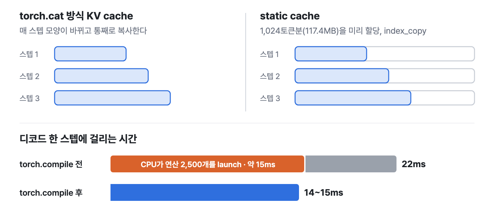

### 양자화

토큰 하나를 만들 때마다 가중치 전체를 메모리에서 읽어야 한다. 1.5GB짜리 영상을 USB에서 옮길 때 시간이 걸리는 것과 같은 원리라고 했다. 가중치를 int8로 줄여 읽을 양을 절반(882 → 441)으로 만들었고 최종적으로 **92 TPS**로 Ollama의 86.8 TPS를 넘겼다.

양자화는 뒤의 세션에서도 계속 나오는데 가중치 하나를 몇 비트로 어떻게 저장하느냐의 차이다.

| 형식 | 가중치 하나 | 표현 방식                                  | 16bit 대비 크기 |
| ---- | ----------- | ------------------------------------------ | --------------- |
| BF16 | 16bit       | 부동소수점. 양자화하지 않은 기준 형식      | 1               |
| int8 | 8bit        | 정수 256단계. 실수 값을 가까운 단계로 근사 | 약 1/2          |
| int4 | 4bit        | 정수 16단계                                | 약 1/4          |

비트가 줄수록 읽을 양은 줄지만 표현할 수 있는 값의 단계도 줄어 원래 값과의 오차가 커진다. int4는 16단계뿐이라 어떻게 반올림하느냐가 결과를 크게 좌우한다.

남은 과제로는 prefill 쪽 최적화(첫 토큰 시간은 여전히 느리다), 4bit 양자화, 배치 처리, speculative decoding을 꼽았다. speculative decoding은 작고 빠른 모델이 토큰 여러 개를 먼저 추측하고 큰 모델이 그 추측을 한 번에 검증해 맞은 만큼 받아들이는 기법이다. 큰 모델을 토큰마다 한 번씩 돌리지 않아도 돼서 결과는 그대로 두고 속도를 올릴 수 있다.

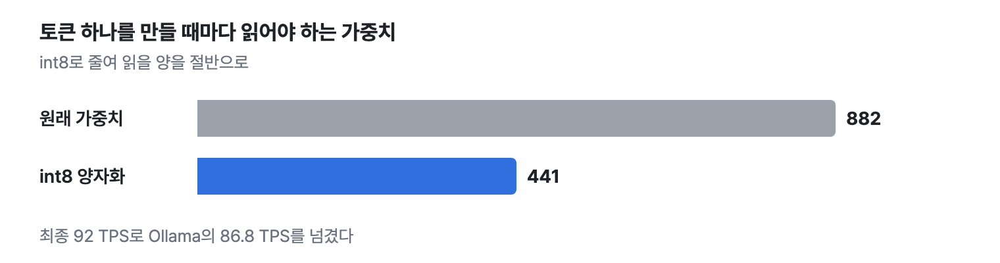

## 2. 작은 모델을 더 작고 빠르게: Unsloth LoRA·TorchAO INT4 QAT부터 vLLM 서빙까지

도메인 특화 소형 모델을 파인튜닝하고, 양자화하고, vLLM으로 서빙한 뒤 비용까지 비교하는 흐름이었다. 평가는 국가시험 기출 약 3천 문항으로 했고 장비는 H100 한 장이었다.

### 파인튜닝: PEFT vs Unsloth

LoRA는 파인튜닝 기법으로, 원래 가중치는 고정해 두고 그 옆에 작은 행렬을 덧붙여 그것만 학습한다. 학습할 파라미터가 전체의 일부라 메모리와 시간이 적게 든다. PEFT는 LoRA 같은 기법을 모아 둔 Hugging Face의 라이브러리다. Unsloth는 오픈소스 라이브러리로, 같은 LoRA 파인튜닝을 더 빠르고 메모리를 덜 쓰게 최적화했다.

같은 LoRA 설정, 같은 데이터로 Hugging Face PEFT와 Unsloth를 비교했다.

- 정답률은 72.3점과 72.2점으로 사실상 같았다. 튜닝 전 베이스라인은 63점대였다.
- 학습 시간은 Unsloth 쪽이 약 35% 짧았고 GPU 메모리도 덜 썼다. 집에 있는 그래픽카드로도 튜닝해 볼 수 있다는 점을 장점으로 꼽았다.
- 두 방식은 gradient checkpointing 처리 방식이 다르다고 한다.

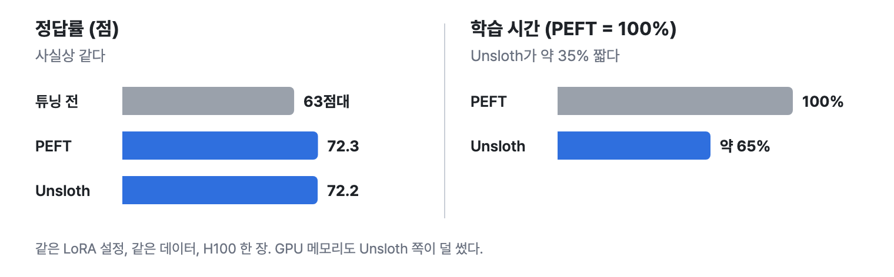

### 양자화: PTQ vs QAT

[TorchAO](https://github.com/pytorch/ao)는 PyTorch 팀이 만든 양자화 라이브러리다. INT4로 줄이는 두 가지 방식을 비교했다.

- **PTQ**(Post-Training Quantization): 16bit로 학습을 끝낸 뒤 마지막에 4bit로 잘라 낸다.
- **QAT**(Quantization-Aware Training): 나중에 줄어들 것을 가정하고 학습 중에 양자화된 값을 반영하면서 학습한다.

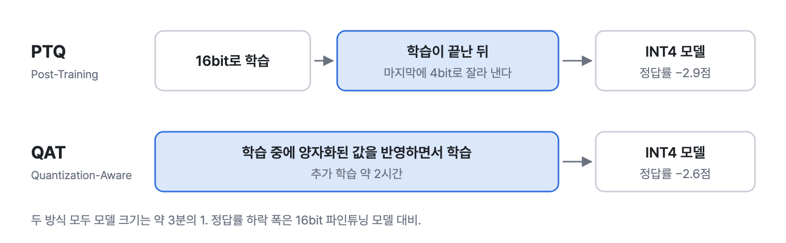

INT4로 줄이면 모델 크기는 약 3분의 1이 된다. 정답률은 PTQ가 2.9점, QAT가 2.6점 내려갔다. 그래도 튜닝 전 베이스라인보다는 6점가량 높다.

흥미로웠던 건 **QAT가 PTQ보다 뚜렷하게 좋지 않았다**는 점이다. 직관적으로는 QAT가 더 높아야 할 것 같은데 시드를 바꿔 여섯 번쯤 돌려 봐도 차이가 1점 이내였고 방향도 일정하지 않았다고 한다. Q&A에서는 QAT에 추가 학습이 2시간 정도 들었는데 이 정도 차이라면 그 비용을 들일 의미가 있을지 모르겠다는 답이 나왔다. 다만 시드 한 번, H100 한 장으로 한 실험이라 단정하기는 어렵다고 덧붙였다.

### 서빙: INT4가 항상 빠르지는 않다

vLLM에서 BF16과 INT4를 동시 요청 수별로 비교했다.

- 동시 요청이 1~4개로 적을 때는 INT4가 더 빨랐다.
- 동시 요청이 16개를 넘어가면 BF16의 처리량이 더 높았고 요청이 많아질수록 차이가 벌어졌다.
- prefix caching을 켜면(프롬프트 약 660토큰) INT4의 첫 토큰 시간이 5분의 1 수준으로 줄었다. 그래도 동시 8개 이상에서는 BF16이 3배 이상 많이 처리했다.

이유에 대해서는 연사 본인의 추측이라고 전제하고, BF16은 잘 최적화된 행렬 연산 커널을 그대로 타는 반면 INT4 경로는 아직 그만큼 최적화되지 않았기 때문으로 보인다고 했다. 결국 **동시 사용자가 얼마나 되느냐에 따라 선택이 달라진다**는 결론이다. 사내 시스템처럼 사용자가 적으면 INT4로도 충분하고, 트래픽이 몰리는 서비스라면 BF16이 유리하다.

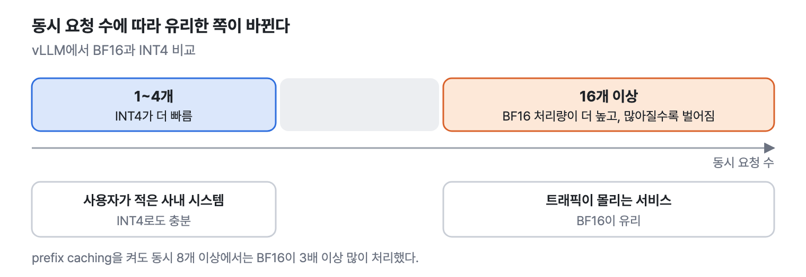

### 프런티어 API와의 비교

프런티어 API 모델들은 대부분 더 정확했다(최고 98.5점). 그런데 한 모델은 58점이 나왔다. 몰라서가 아니라 **콘텐츠 필터에 걸려 답을 하지 않아서**였다. 의료 도메인 문제라 생긴 일이다. 반대로 비즈니스에서는 절대 답하면 안 되는 것도 있으니 필터를 직접 통제할 수 있다는 점이 자체 서빙의 이유가 될 수 있다는 이야기였다.

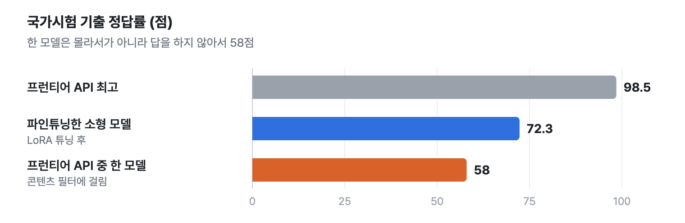

## 3. The Search It Never Made

1.2B짜리 온디바이스 모델이 **웹 검색을 해야 할 때를 아는가**를 실제 폰에서 측정한 내용이다.

### 문제 설정

연사 팀은 Open Weights라는 Android 앱을 만들고 있다. 계정도 클라우드도 없이 폰에서만 돌아가고, llama.cpp(GGUF)와 ExecuTorch(`.pte`) 두 엔진을 지원한다. 폰 밖으로 나가는 건 모델이 요청한 웹 검색 하나뿐이다. 그래서 검색 여부 판단이 중요하다.

[ExecuTorch](https://github.com/pytorch/executorch)는 PyTorch의 온디바이스 추론 런타임으로, PyTorch 모델을 폰이나 임베디드 기기에서 돌리기 위해 쓴다. 모델을 미리 `.pte` 파일로 내보내(export) 컴파일해 두고, 기기에서는 가벼운 런타임이 그 파일을 읽어 실행한다. 뒤에 나오는 "컴파일 파일"이 이 `.pte`를 가리킨다.

llama.cpp 쪽은 GGUF라는 모델 파일 형식을 쓴다. 가중치(보통 양자화된 것)와 토크나이저, 메타데이터를 파일 하나에 담는다. Ollama가 내려받는 모델도 이 형식이다.

틀리는 방법은 두 가지다.

- **너무 적게 검색한다** → 기억에서 답하다가 hallucination이 생긴다.
- **너무 많이 검색한다** → 느려지고, 발열이 생기고, 연결이 필요해진다.

실제로 "닌텐도의 CEO는 누구인가"를 물었더니 모델이 "웹 검색으로 최신 정보를 확인했다"면서 존재하지 않는 이름을 답했다. 검색은 실행되지 않았고 화면 어디에도 그 사실은 표시되지 않았다.

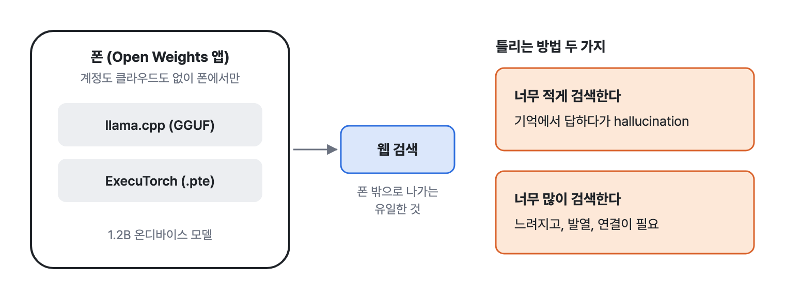

### 측정

RetrievalQA, PopQA, FreshQA에서 가져온 공개 질문 160개를 실제 앱, 실제 모델 파일, 실제 웹 검색으로 실제 폰에서 돌렸다. 발표 자료에는 검색에 DuckDuckGo를 쓴다고 적혀 있었던 것으로 기억한다. 질문마다 "기억으로 답할 수 있는가"라는 라벨이 데이터셋에 이미 붙어 있다. 질문마다 세 가지를 봤다.

- 필요할 때 검색했는가
- 필요 없을 때 검색했는가
- 검색했다고 말해 놓고 실제로는 안 했는가

LFM2.5 1.2B의 ExecuTorch 컴파일 파일은 **검색이 필요한 75개 질문 중 3개만** 검색했고 30여 개 답변에서는 검색했다고 거짓으로 말했다. 같은 모델의 4bit GGUF는 30여 번 검색했고 거짓 주장은 없었다.

같은 모델, 같은 4bit인데 파일이 다르면 행동이 달랐다. 모델 탓을 그만두고 파일을 들여다보기 시작한 지점이라고 했다.

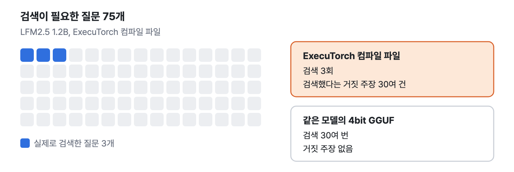

### 원인 두 가지

- **남은 state**: 새 채팅이 이전 채팅의 state 위에서 시작됐다. 김치볶음밥 레시피를 물은 뒤 새 채팅에서 전혀 다른 걸 물어도 김치볶음밥 이야기가 섞여 나오는 식이다. ExecuTorch 저장소에 이슈를 올리고 PR도 보냈다고 한다.
- **거친 반올림**: 각 가중치를 가장 가까운 값으로 반올림해 4bit로 줄였는데 작은 오차가 레이어를 지나며 쌓였다.

둘 다 에러를 내지 않는다. 모델은 여전히 유창하게 쓰는데 틀린다.

어디서 깨지는지 보려고 원본 모델이 툴을 호출하는 질문 16개로 노트북에서 실험했다.

| 설정                     | 툴 호출 (16개 중) |
| ------------------------ | ----------------- |
| 양자화 없음              | 16                |
| activation만 8bit        | 16                |
| attention만 4bit         | 16                |
| feed-forward만 4bit      | **0**             |
| 같은 4bit, GPTQ로 반올림 | 16                |

> 기억으로는 0이 나온 설정이 하나 더 있었는데 기록이 잘 남지 않았다. 결론이 달라지는 내용은 아니다.

문제는 4bit 자체가 아니라 **4bit로 어떻게 반올림하느냐**였다. GPTQ는 가중치를 하나씩 따로 반올림하지 않고 각 레이어의 출력이 원본에 가깝게 유지되도록 반올림 값을 고른다. 파일 크기는 같다.

GPTQ는 재학습 없이 적용하는 양자화 기법이다. 소량의 샘플 데이터를 모델에 흘려 보내 각 레이어의 입력을 모은 다음, 가중치를 차례로 반올림한다. 그때 생긴 오차는 아직 반올림하지 않은 나머지 가중치를 조정해 상쇄한다.

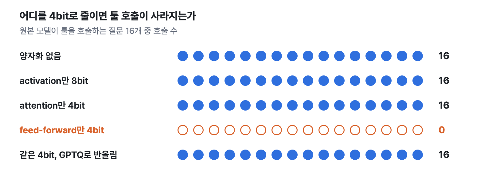

### 고치기

- **파일을 고친다**: state를 지우면 검색이 3 → 9회, GPTQ까지 적용하면 38회로 GGUF보다 많아졌다. 거짓 검색 주장은 0이 됐고 디코딩은 GGUF보다 약 1.5배 빨랐다. 컴파일된 파일이 본질적으로 나쁜 건 아니었다. 레시피 문제였다.
- **앱이 잡는다**:
  - intent rule — 답변이 "검색했습니다", "찾아볼게요"인데 검색이 실행되지 않았으면 앱이 검색을 실행한다. 거짓 주장이 32 → 2건으로 줄었다.
  - doubt gate — 모델의 토큰 확률이 낮으면 앱이 검색한다. 다만 토큰별 확률이 필요한데 컴파일된 ExecuTorch 모델은 현재 이를 노출하지 않는다.

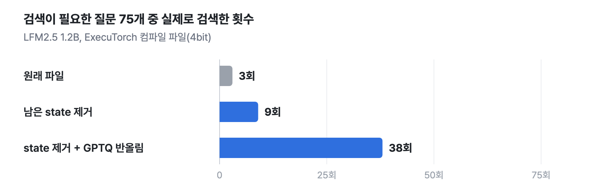

### 새 모델은 문제를 옮길 뿐이다

더 새로운 1.7B 모델은 같은 단순 반올림에도 75개 중 70개에서 툴 호출을 유지했다. 대신 이번엔 **너무 많이** 검색했다. 검색이 필요 없는 질문 60개 중 37개에서 검색을 했다. 압축하지 않은 원본도 똑같이 행동했으니 이건 압축이 아니라 모델의 습관이다.

검색한다고 맞히는 것도 아니었다. 127번 검색 중 결과에 답이 들어 있던 건 59번뿐이었다. 답이 있을 때는 56번을 잘 활용했으니 약한 고리는 모델이 아니라 검색이 돌려주는 결과였다.

발표 주에 찾았다는 버그도 하나 소개했다. 이 모델은 답하기 전에 thinking을 하는데 ExecuTorch 경로에는 thinking을 멈추게 하는 장치가 없어서 생각 도중에 잘린 답변이 69건 있었다. 미완성 텍스트를 채점하고 있었다. llama.cpp의 방식을 따라 "충분히 생각했다"는 문장과 닫는 think 태그를 붙여 주는 수정으로 0건이 됐다. 이전에 공개했던 정답 75개는 잘린 답을 오답 처리하면 실제로는 59개였고, 수정 후에는 69개였다고 스스로 정정했다.

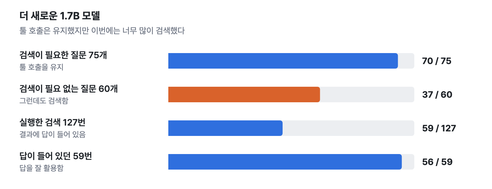

### 정리

1. 양자화를 **하느냐**가 아니라 **어떻게** 하느냐가 중요하다.
2. 선택적인 툴은 모두 같은 판단 위에 올라가 있다.
3. 새 모델이 자동으로 더 안전하지는 않다.
4. **조용히 실패한다.** 이게 가장 큰 문제다.

툴을 쓰는 모델을 배포하기 전에는 실제로 배포할 파일, 런타임, 프롬프트 조합으로 직접 확인해야 한다는 결론이었다. 공개된 폰 벤치마크는 llama.cpp 빌드만 다루고 모델이 호출을 결정하는지는 확인하지 않기 때문이다.

## 4. Ray 기반 엣지 환경에서의 고성능 LLM 서빙

데이터센터급 GPU가 아니라 RTX 4090, 5090 같은 GPU가 지리적으로 흩어져 있는 환경에서 멀티턴 AI 채팅 서비스를 PoC로 대응한 경험을 공유했다.

[Ray](https://github.com/ray-project/ray)는 오픈소스 분산 컴퓨팅 프레임워크로, 파이썬 코드를 여러 대의 머신에 나눠 실행하게 해 준다. 그 위에 학습용 Ray Train, 모델 서빙용 Ray Serve 같은 라이브러리가 올라가 있어 AI 워크로드의 클러스터 운영에 많이 쓰인다.

### 멀티턴 채팅의 요구사항

- 일반적인 요청보다 긴 컨텍스트를 처리해야 한다.
- 한 번으로 끝나지 않고 몇 분 간격으로 대화가 이어진다.
- 캐시된 대화만 오는 게 아니라 새 대화도 계속 들어온다.

GPU를 키우는 스케일업은 불가능하니 노드를 늘리는 스케일아웃으로 가야 한다. 그러면 **"이 대화의 KV cache가 어느 노드에 있는가"**가 문제가 된다. 다음 턴이 캐시가 없는 노드로 가면 prefill을 처음부터 다시 해야 하기 때문이다.

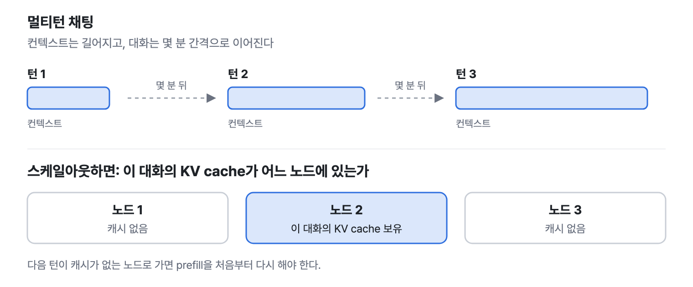

### Ray와 KV-aware 라우팅

오케스트레이션은 Ray를 쓴다. 컨트롤 플레인인 head와 데이터 플레인인 worker로 이루어져 있다는 점에서 Kubernetes와 비슷하고, worker에 문제가 생기면 주기적인 헬스 체크로 감지해 다른 worker에 replica를 다시 할당한다. 그 위에서 Ray Serve로 모델을 배포하고 vLLM 같은 엔진을 추상화해 주는 Ray Serve LLM도 분석해 적용하고 있다고 했다.

라우팅의 딜레마는 이렇다. KV cache가 있는 worker로만 보내면 그 worker가 이미 다른 요청을 디코딩하느라 바쁠 때 캐시가 있어도 즉시 처리하지 못한다. 그래서 **캐시 보유 여부와 현재 부하를 함께 점수화**해 라우팅하고 둘 사이의 가중치를 조절할 수 있게 했다. Ray에 있는 기능을 그대로 쓰지 않고 커스터마이즈했다고 한다.

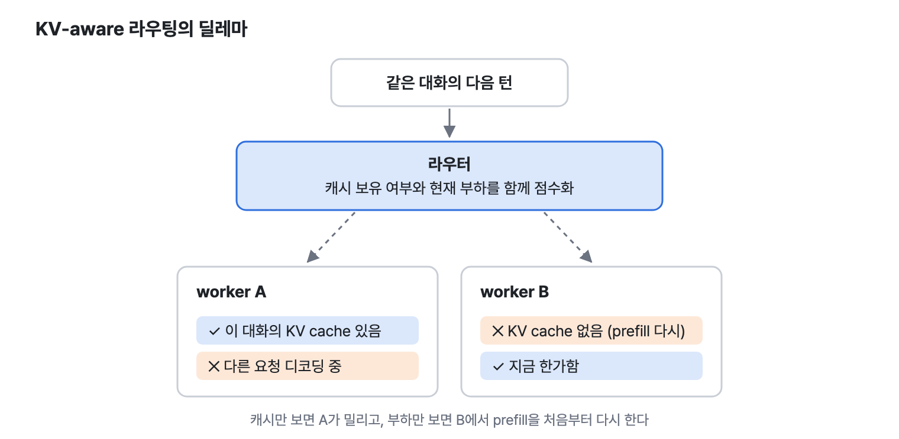

### KV cache offloading

RTX급 GPU는 모델과 KV cache를 함께 올리기에 VRAM이 부족하다. 그래서 VRAM → DRAM → NVMe 순으로 KV cache를 계층적으로 내려 보관해 캐시 히트율을 높였다.

NVMe는 가장 느린 계층이라 I/O 병목이 생겼는데 디스크 구성을 바꿔 I/O를 분산시키는 방식으로 TTFT와 캐시 히트율을 개선했다고 한다.

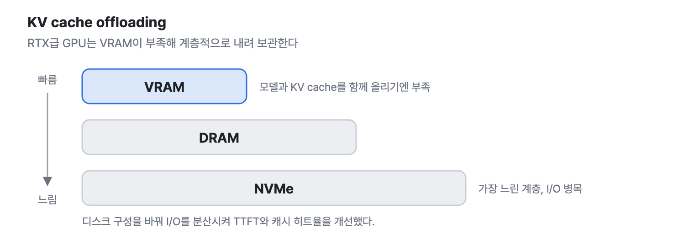

### 결과와 교훈

내부 벤치마크에서 처리량이 늘고 TTFT가 절반 수준으로 줄었다. 캐시 히트율은 즉시 재요청에서 75%, 5분 이상 지난 뒤 재방문에서는 95%가 나왔다. 멀티턴 채팅은 사용자가 한참 뒤에 다음 메시지를 보내는 경우가 많아 뒤쪽 숫자가 중요하다.

실제 PoC에서는 **캐시 히트율을 달성했는데도 tail latency가 SLO를 만족하지 못하는** 구간이 있었다. 캐시가 맞는다고 빨라지지는 않아서 디코드 단계도 함께 대응해야 했고, vLLM 설정 조정과 용량 증설을 거쳐 SLO를 맞췄다고 한다.

운영 안정성 쪽에서는 worker가 지리적으로 떨어져 있다 보니 Ray head가 죽는 문제를 겪었다고 한다.

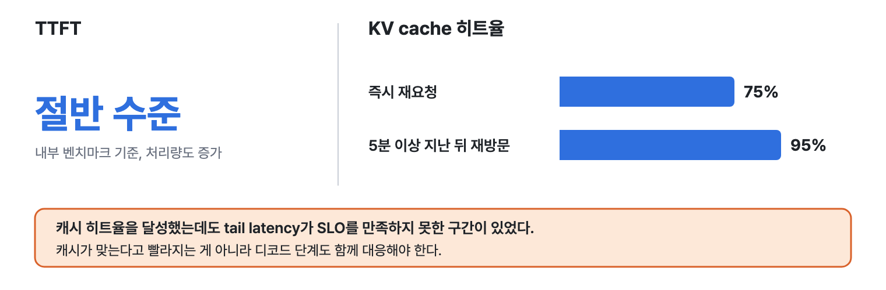

## 5. 모델을 학습하며 마주한 메모리 병목과 최적화

마지막 세션은 학습 쪽 이야기였다. Trillion Labs가 MoE 모델과 VLM을 처음부터 학습하면서 만난 시스템 성능 문제 세 가지를 다뤘다. 목표는 같은 GPU, 같은 시간 안에 원하는 설정으로 학습이 돌아가게 하고 더 빠르게 만드는 것이다.

대상 모델은 Gravity 시리즈다. Gravity-Bio-16B-A3B는 루닛 등과 컨소시엄을 구성해 STEM·의료 중심으로 학습한 공개 모델로, pre-training부터 SFT, RL까지 직접 했고 pre-training에 5.5T 토큰을 썼다고 한다. 28레이어 decoder-only 트랜스포머에 MoE는 expert 64개 중 8개가 활성화되는 구조다. 여기에 비전 인코더를 붙인 VLM도 내부적으로 학습했다.

### 문제 1 — 롱 컨텍스트에서 cross-entropy OOM

LLM은 보통 8K로 충분히 학습한 뒤 32K, 128K로 컨텍스트를 늘려 간다. 컨텍스트를 늘리자 cross-entropy 계산 시점에 메모리가 튀면서 OOM이 나서 한 스텝도 진행하지 못했다.

학습 중 GPU 메모리는 weight, gradient, optimizer state, activation, 그리고 logits가 차지한다. 앞의 것들은 FSDP와 gradient checkpointing으로 이미 줄여 놓은 상태였다. 남은 게 logits다.

logits는 마지막 hidden state에 LM head를 곱한 값으로, 크기가 **시퀀스 길이 × vocab 크기**다. 128K × 10~20만이니 메모리에 올리는 것 자체가 큰 부담이다. 그런데 logits는 loss를 계산할 때만 필요하다.

해법은 **Fused Linear Cross-Entropy**다. 시퀀스를 chunk로 나눠 chunk마다 logits와 loss를 계산하고 필요한 gradient(LM head weight에 대한 것과 hidden state에 대한 것)만 누적한다. 전체 logits를 한 번도 materialize하지 않는다. 직접 만든 것은 아니고 Liger Kernel 등에 구현이 있다고 소개했다.

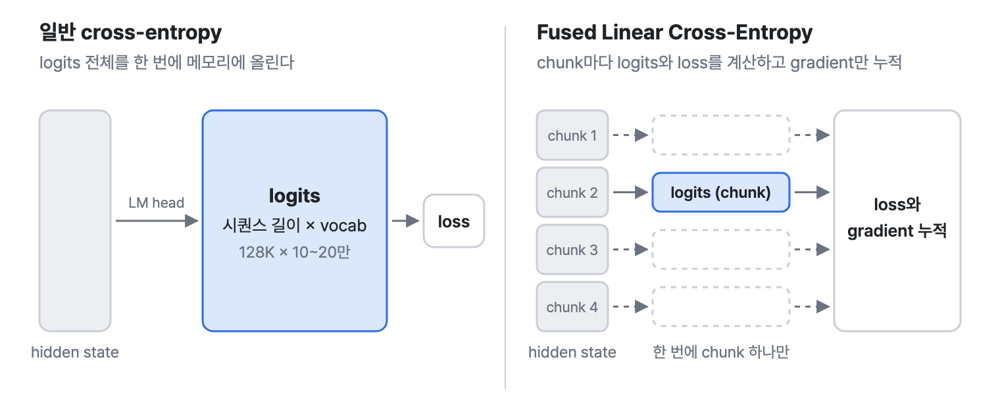

chunk 크기로 메모리를 통제할 수 있게 됐고 의외로 32K, 128K에서는 일반 cross-entropy보다 **더 빨랐다**. Q&A에서 이유를 묻자 알고리즘 자체보다는 메모리 연산에 최적화된 커널 구현의 차이일 가능성이 크다고 답했다.

### 문제 2 — MoE의 gather/scatter

요즘 MoE는 expert 수를 늘리고(수백 개) 각 expert를 작게 만드는 추세다. 활성 expert 수 K가 늘어도 expert의 hidden dimension × K는 대체로 일정하게 두기 때문에 실제 행렬곱 비용은 거의 그대로다.

반면 토큰을 expert별로 모으는 **gather**와 결과를 다시 흩는 **scatter**는 사정이 다르다. 라우팅만 하는 과정인데 여기서 만들어지는 중간 텐서가 시간과 메모리 양쪽에서 병목이었다.

해법은 FlashAttention을 만든 랩에서 나온 **SonicMoE**였다. 중간값을 만드는 게 병목이니 아예 만들지 않는다.

- gather: 토큰을 복사해 모으지 않고 expert별로 가져갈 토큰의 **인덱스만** 저장해 런타임에 꺼내 쓴다.
- backward에 필요한 중간 activation: forward 때 계산하되 저장하지 않고 backward에서 필요할 때 **다시 계산**한다.

기존 방식은 expert 수가 늘수록 step time과 activation memory가 가파르게 올라가는데 SonicMoE는 거의 평평했고 16B 모델 학습에서 2배 이상 빨라졌다고 한다.

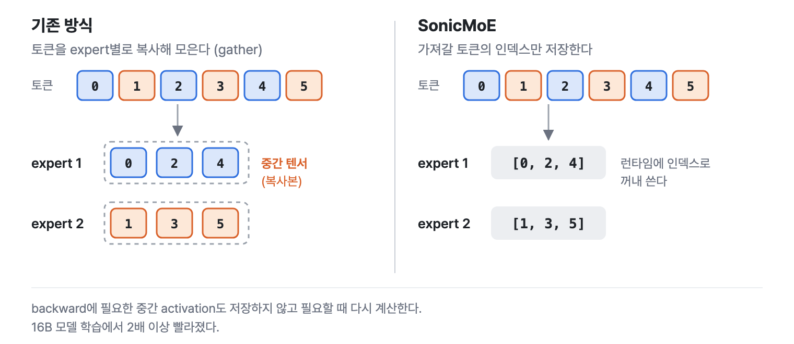

### 문제 3 — VLM을 붙였더니 처리량이 3분의 1

텍스트만 학습할 때 처리량이 약 33,000 TPS였는데 ViT를 붙여 이미지와 함께 학습하니 3분의 1 수준(35%)으로 떨어졌다. ViT는 전체 파라미터의 2.9%밖에 안 되는데 말이다.

**ViT 자체의 최적화 누락**

- `torch.compile`이 빠져 있었다. 다만 이미지는 크기가 매번 달라서 그냥 켜면 계속 recompile이 일어난다. `dynamic` 옵션으로 해결했다.
- FlashAttention을 적용하려 했는데 backward에서 헤드 수가 32의 배수여야 한다는 제약이 있었고 이 ViT는 헤드가 72개였다. 96개로 패딩해 커널을 태운 뒤 나머지 24개를 떼어 내는 방식으로 우회했다.

이 둘로 35% → 66%까지 올라왔다.

**멀티 GPU에서 GPU가 서로를 기다리는 문제**

gradient를 모으는 synchronize 단계는 모든 GPU가 도착해야 진행된다. 그런데 어떤 GPU는 이미지를 많이, 어떤 GPU는 텍스트만, 어떤 GPU는 큰 이미지를 받으면 스텝 시간이 제각각이 되고 전체가 가장 느린 쪽을 기다리게 된다.

- 텍스트 배치와 비전 배치를 분리했다. 예를 들어 텍스트만 4번, 비전 포함 1번을 학습하고 gradient accumulation으로 하나의 스텝으로 묶는다. 여기서 12%p가 더 올라 78%가 됐다.
- 4000×4000 같은 고해상도 이미지에서는 이것만으로 부족해서 데이터 로더에서 배치별 이미지 예산을 미리 계산하고 그에 맞춰 샘플을 배치하는 bin packing을 추가했다. 고해상도 기준으로 4% 정도 더 얻었다.

결과적으로 텍스트 전용 대비 35%였던 학습 속도를 **78%**까지 끌어올렸다.

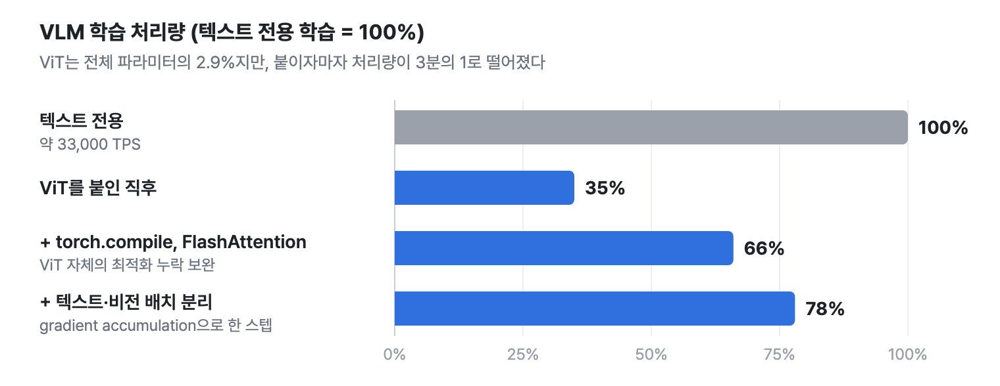

## 덧붙임: PyTorch, vLLM, Ollama

세션을 들으면서 세 이름이 계속 섞여 나와서 관계를 따로 정리해 봤다.

**PyTorch와 vLLM**은 위아래 관계다. PyTorch는 텐서 연산과 모델 실행을 맡는 프레임워크이고, vLLM은 그 위에 만든 LLM 서빙 엔진이다. 모델의 forward 자체는 PyTorch가 하고, vLLM은 여러 요청을 묶어 처리하는 배치, KV cache 메모리 관리, prefix caching, API 서버 같은 서빙에 필요한 부분을 얹는다. 1번 세션에서 손으로 만들어 본 것들을 서버 규모로 해 주는 쪽이라고 보면 된다.

**vLLM과 Ollama**는 둘 다 추론 엔진이지만 겨냥하는 곳이 다르다.

| 구분      | vLLM                                   | Ollama                                  |
| --------- | -------------------------------------- | --------------------------------------- |
| 용도      | 서버에서 많은 동시 요청을 처리         | 개인 장비에서 모델을 간편하게 실행      |
| 기반      | PyTorch                                | llama.cpp (PyTorch를 쓰지 않는다)       |
| 모델 형식 | Hugging Face 형식의 가중치             | GGUF (보통 양자화된 것)                 |
| 장비      | 데이터센터급 GPU                       | 노트북의 CPU, Apple Silicon, 일반 GPU   |
| 강점      | 동시 요청이 많을 때의 처리량           | 설치와 모델 관리가 쉽다                 |

그래서 1번 세션은 비교 대상이 Ollama였고, 서빙을 다룬 2번과 4번 세션은 vLLM 위에서 이야기가 진행됐다.

## 마무리

다섯 세션을 관통한 건 "측정하고, 어디가 느린지(혹은 틀리는지) 찾고, 중간에 낭비되는 것을 없앤다"였다.

- 추론에서는 이미 계산한 attention을 다시 계산하지 않는다(KV cache).
- 학습에서는 한 번만 쓰는 logits나 expert 라우팅용 중간 텐서를 만들지 않는다(FLCE, SonicMoE).
- 분산 서빙에서는 이미 만들어 둔 KV cache가 있는 곳으로 요청을 보낸다(KV-aware 라우팅).

그리고 양자화는 세 세션에 걸쳐 서로 다른 얼굴로 나왔다. 로컬 추론에서는 TPS를 올리는 마지막 한 수였고, 서빙에서는 동시 요청이 많아지면 오히려 불리해지는 선택이었으며, 온디바이스에서는 반올림 방식 하나로 툴 호출이 통째로 사라지는 원인이었다. "줄이면 빨라진다"로 끝나는 이야기가 아니라는 걸 하루에 세 번 확인한 셈이다.

개인적으로는 Trillion Labs 세션이 가장 좋았다. 모델을 처음부터 직접 학습하면서 겪은 문제를 당사자에게 들을 수 있는 자리가 흔치 않기 때문이다. 저 회사에 가면 모델을 학습하는 경험만큼은 확실히 할 수 있겠다는 생각이 들어서 매력적으로 느껴졌다. 앞으로의 행보도 응원한다.
