2026년 11월 22일(일)에 열린 PyTorch Korea Deep Dive에 다녀왔다. 전날 [PyTorch Day Korea 2026](/2026/11/21/pytorch-day-korea-2026-후기)에 이어 이틀 연속이다.

전날 행사가 PyTorch를 쓰는 쪽의 이야기였다면, 이날은 PyTorch를 만드는 쪽의 이야기였다. 발표자 대부분이 Meta의 PyTorch 팀 소속이었고 발표는 영어로 진행됐다.

> 글에 들어간 이미지들은 발표 자료가 아니라, 정리한 내용을 바탕으로 AI와 함께 만든 것이다.

| 시간  | 세션                                           | 발표자         |
| ----- | ---------------------------------------------- | -------------- |
| 13:40 | How to (Properly) Write PyTorch C++ Extensions | Jane Xu        |
| 14:10 | Dynamic Shape CUDA Graphs                      | Elias Ellison  |
| 14:50 | Attention Gym                                  | Driss Guessous |
| 15:20 | PyTorch at Frontier: From kernels to clusters  | Sherlock Huang |
| 16:00 | vLLM TorchTPU                                  | Tiezhen Wang   |

아쉽게도 아직 모든 내용을 이해하지는 못했다. 보면서 공부할 예정이다.

## 1. How to (Properly) Write PyTorch C++ Extensions

발표자는 Jane Xu다. PyTorch의 옵티마이저(`torch.optim`)와 C++ API(LibTorch, Stable ABI)의 메인테이너다.

한 줄로 줄이면 **"LibTorch에 안정 ABI가 생겼으니 C++ 커스텀 연산은 그 위에서 작성하라"** 는 발표였다.

### 문제: Torch가 올라가면 확장도 다시 빌드한다

PyTorch에 없는 연산이 필요하거나 특정 연산을 직접 최적화하고 싶으면 C++나 CUDA로 커스텀 연산을 작성해 확장 모듈로 붙인다. vLLM, flash-attention, torchvision, torchaudio가 모두 이런 확장을 갖고 있다.

이 확장들은 `libtorch.so`가 내보내는 C++ API에 직접 의존한다. 문제는 이 API가 안정적이지 않다는 점이다. Torch 버전이 올라가면 확장도 다시 빌드해야 한다.

여기서 **API**와 **ABI**를 구분해야 한다.

- API(Application Programming Interface)는 소스 코드 수준의 약속이다. 함수 이름과 인자가 같으면 API는 같다.
- ABI(Application Binary Interface)는 컴파일된 바이너리 수준의 약속이다. `.so` 파일끼리 실제로 어떻게 호출하고 데이터를 주고받는지를 정한다.

소스의 API가 그대로여도 컴파일러나 컴파일 플래그가 달라지면 ABI는 바뀔 수 있다. 그래서 ABI 안정성은 약속하기가 어렵고, 그만큼 값지다고 했다.

안정 ABI가 없으면 빌드 수가 곱으로 늘어난다. Python 버전이 M개, Torch 버전이 N개라면 같은 코드로 wheel을 M×N개 만들어야 한다. wheel은 Python 패키지의 빌드된 배포 파일이다.

### 해법: 3계층 구조

LibTorch는 대부분 C++로 작성돼 있다. 그런데 C++는 네임 맹글링(컴파일러가 함수 이름에 타입 정보를 섞어 심볼 이름을 만드는 것) 때문에 ABI를 고정하기가 어렵다. 그래서 C로 된 층을 하나 올렸다.

| 계층            | 위치                | 역할                                                                                                                     |
| --------------- | ------------------- | ------------------------------------------------------------------------------------------------------------------------ |
| **C shim**      |                     | 기존 API 위에 올린 얇은 C 층이다. 아래의 Torch가 바뀌어도 이 층은 그대로 유지되면서 변화를 흡수한다.                     |
| **C++ 래퍼**    | `torch/csrc/stable` | C는 장황해서 쓰기 불편하다. 원래 API와 비슷하게 생긴 고수준 C++ 래퍼를 제공한다. C shim과 header-only에만 의존한다.      |
| **header-only** | `torch/headeronly`  | scalar type 같은 enum과 타입은 LibTorch와 함께 빌드될 필요가 없다. 헤더 안에 전부 구현돼 있어 PyTorch 없이도 쓸 수 있다. |

발표자는 이 구조를 손그림으로 보여 줬다. `libtorch`의 윗면은 들쭉날쭉한데, 그 위에 C shim이 평평한 면을 덮고 있는 그림이다. 들쭉날쭉한 면이 버전마다 바뀌는 불안정한 API이고, 확장은 평평한 면에만 닿는다.

안정 ABI를 쓰면 포함할 수 있는 헤더가 이 세 계층으로 제한된다. 빌드할 때는 `TORCH_TARGET_VERSION`을 넘긴다. 2.10을 지정하면 2.10, 2.11, 2.12에서 모두 돌아간다.

제약은 PyTorch 2.10 이상에서만 된다는 것이다. 아직 안정화되지 않은 API가 필요하면 이슈로 요청해 달라고 했다.

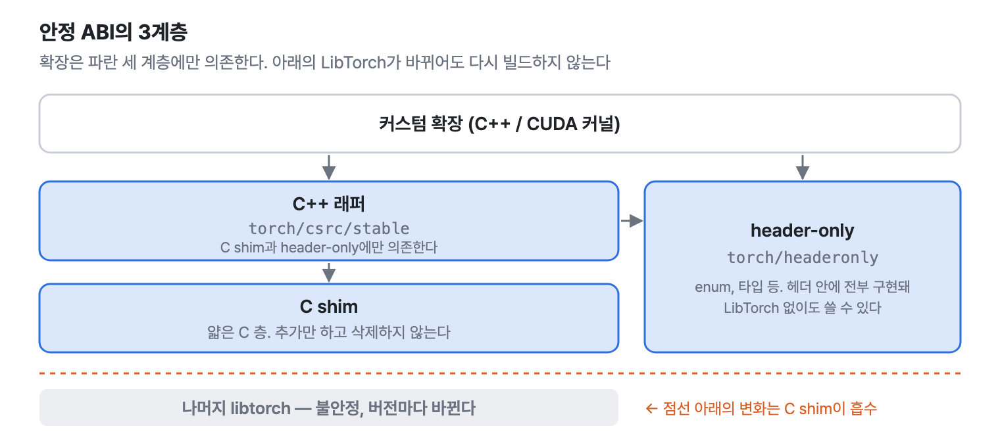

### 예제: muladd 연산을 처음부터 끝까지

`a * b + c`를 계산하는 CUDA 연산을 만들어 보였다. 실용적인 연산은 아니지만 커스텀 연산을 작성할 때 쓰는 API를 고루 보여 준다.

1. **스키마 정의**: 일반 `torch::Tensor` 대신 stable 텐서 두 개와 `double c`를 받고 결과 텐서를 돌려준다.
2. **입력 검사**: 기존 `TORCH_CHECK`에 대응하는 `STD_TORCH_CHECK`가 있다. a와 b가 float인지, 크기가 같은지, CUDA 위에 있는지 확인한다.
3. **CUDA 커널 작성**: 커널 입장에서 텐서는 `float*`일 뿐이다. 포인터 두 개와 스칼라, 출력 포인터를 받아 계산한다.
4. **커널 호출 준비**: `contiguous`, `empty_like` 같은 연산을 stable 네임스페이스에서 호출한다. 데이터 포인터는 읽기 전용 `const_data_ptr`과 쓰기용 `mutable_data_ptr`로 나뉜다. 기존의 `.data_ptr()` 하나보다 엄격하다.
5. **등록**: stable 버전의 torch library 매크로에 확장 이름을 주고, `m.def`로 스키마를, 이어서 구현을 등록한다.
6. **Python에서 로드**: 빌드한 `.so`를 `torch.ops.load_library`로 불러오면 `torch.ops.<확장>.<연산>`으로 호출할 수 있다.

눈에 띈 건 4번의 **스트림 API**다. CUDA 커널을 작성하고 있지만 이 API는 CUDA 전용이 아니다. accelerator의 "current stream" 계약을 지키는 하드웨어라면 공통으로 동작한다. 커널 하나를 작성해 여러 하드웨어를 겨냥하는 것이 먼 목표이고, 지금은 하드웨어 벤더들이 인터페이스에 합의하도록 만드는 단계라고 했다.

6번에서 `PyInit` 같은 방식을 권하지 않는 이유도 설명했다. 그런 방식은 확장이 CPython에 직접 묶인다. LibTorch가 이미 CPython에 묶여 있으니 그것을 재사용하면 확장 자체는 CPython에서 자유로워진다.

Python 쪽에도 `Py_LIMITED_API`라는 비슷한 장치가 있다. 둘을 함께 쓰면 wheel 수가 이렇게 줄어든다.

| 단계                              | wheel 수 |
| --------------------------------- | -------- |
| 아무것도 쓰지 않음                | M × N    |
| `TORCH_TARGET_VERSION` (Torch 축) | M        |
| + `Py_LIMITED_API` (Python 축)    | 1        |

OS나 CUDA 버전 같은 다른 축은 여전히 남는다. 그래도 두 축을 없애는 것만으로 빌드 시간이 크게 줄어든다.

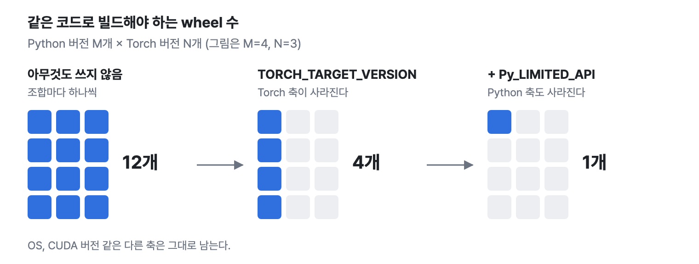

### 제대로 했는지 확인하는 도구

- **ABI 검사 도구**: Ralf Gommers가 만든 커뮤니티 도구다. 빌드된 `.so` 바이너리를 직접 읽어 안정 심볼과 불안정 심볼 중 무엇을 쓰는지 알려 준다.
- **`torch.library.register_fake`**: `torch.compile`과 함께 쓰려면 출력 shape 같은 메타데이터를 알려 주는 fake 구현을 등록한다. C++로도 할 수 있지만 Python으로 하기를 권했다.
- **`torch.library.opcheck`**: 등록이 올바른지 확인한다. 연산 결과가 맞는지는 검사하지 않으니 테스트는 따로 작성해야 한다.

### 생태계가 풀린다

발표자가 "더 재미있는 이유"라고 한 부분이다.

2025년 초에는 안정 ABI가 없어 모든 확장이 `libtorch.so`에 묶여 있었다. Torch가 올라가면 모든 확장이 올라가야 하고, 그 확장에 의존하는 프로젝트도 따라 올라가야 했다. 모두가 서로 엉켜 있었던 셈이다.

안정 ABI 위에서는 각 프로젝트가 자기 속도로 움직일 수 있다. torchaudio가 가장 먼저 안정화됐고 런타임의 Torch 버전 고정도 일찍 풀었다. torchvision도 안정화됐지만 런타임 고정은 아직 유지한다. vLLM은 최근에 안정화됐다.

ABI 호환성은 Torch 버전을 고정하는 여러 이유 중 하나일 뿐이라, 고정을 완전히 풀려면 다른 문제도 해결해야 한다. 그래도 고정이 풀리면 개발이 빨라진다. PyTorch의 버그를 고쳐 확인할 때 커스텀 연산을 다시 빌드하지 않아도 된다. vLLM은 빌드에 20~30분이 걸리기 때문에 이 차이가 크다.

### 다음 계획: 디스패처 없이 쓰기

연산을 디스패처에 등록하면 여러 기능을 얻는 대신 호출마다 1마이크로초 정도의 오버헤드가 붙는다. CUDA graph나 graph capture를 쓰면 이 오버헤드는 사라진다.

그런데 작은 배치의 디코드 커널처럼 커널 전체가 몇 마이크로초인 경우에는 1마이크로초가 크게 보인다. 이런 경우를 위해 nanobind로 디스패처를 거치지 않고 안정 ABI를 쓰는 방법을 준비하고 있다고 했다. pybind는 CPython 안정 ABI를 지키지 않으니 쓰지 말라는 말도 덧붙였다.

기본 권장은 여전히 디스패처를 거치고 graph capture로 오버헤드를 없애는 쪽이다.

### 질의응답

**안정 API가 나중에 제거될 수도 있는가?**

C shim 계층은 추가만 하고 삭제하지 않는다. C++ 래퍼 계층은 갱신할 수 있지만, 헤더 전용이라 확장 안에 컴파일돼 들어가므로 영향이 작다. 안정으로 승격하는 기준이 따로 있지는 않으니 그냥 처음부터 안정 ABI로 작성하라고 했다.

**free threading 때문에 wheel이 결국 두 개 아닌가?**

맞다고 인정했다. 지금은 free-threaded용과 일반용을 따로 빌드하기를 권한다.

**가속기 API 통합이 정말 가능한가?**

가능하다고 단언하기는 어렵지만 시도하고 있다고 답했다. graph, event, stream처럼 가속기들이 공유하는 구성 요소를 찾아 합의를 만들고 있고, 주로 Intel을 비롯한 하드웨어 벤더들이 직접 참여하고 있다.

## 2. Dynamic Shape CUDA Graphs

발표자는 Elias Ellison이다. PyTorch 컴파일러 팀에서 TorchInductor와 CUDA Graph Tree를 맡고 있다.

한 줄로 줄이면 **"CUDA graph를 크기마다 따로 캡처하지 말고, 하나를 캡처해 여러 크기에 재사용하자"** 는 발표였다.

### CUDA graph란

전날 들은 로컬 추론 엔진 세션에서, 디코드 한 스텝 22ms 중 약 15ms가 GPU가 일하는 시간이 아니라 CPU가 연산 2,500개를 하나씩 실행시키는 시간이었다는 이야기가 나왔다. CUDA graph는 이 문제를 정면으로 겨냥한다.

CUDA graph는 GPU 작업의 정적인 기록이다. 커널들이 어떤 순서로 실행되는지를 한 번 캡처해 두고, 이후에는 GPU API 호출 한 번으로 통째로 재생한다. 커널 사이사이에 끼어 있던 CPU 작업이 전부 사라진다. 커널 여러 개를 커널 하나처럼 띄우는 셈이다.

정적 shape 워크로드에서는 항상 이득이다. CPU 오버헤드에 묶여 있었다면 크게 빨라지고, 아니어도 커널 실행마다 고정된 시간을 아낀다.

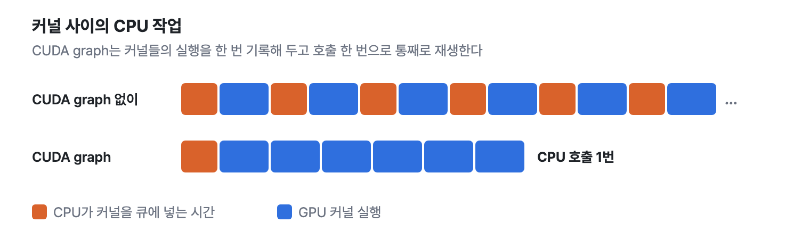

### 한계 두 가지

캡처할 때 커널에 넘긴 인자가 그대로 기록된다. 그 인자는 주로 **크기**와 **메모리 주소**다. 그래서 두 가지가 고정된다.

**크기가 고정된다.** 흔한 우회책은 패딩이다. 64, 128, 256 같은 크기로 미리 캡처해 두고, 실제 입력을 가장 가까운 큰 크기까지 채운다.

- 채운 부분만큼 메모리 읽기와 쓰기를 낭비한다.
- 버킷을 늘리면 낭비는 줄지만 워밍업이 길어진다.
- 동적인 차원이 여러 개면 조합이 곱으로 늘어난다. 이 경우 CUDA graph를 아예 못 쓰기도 한다.

vLLM이나 SGLang에서 캡처할 크기를 설정하고 긴 워밍업을 기다리는 것이 이 때문이다.

**주소가 고정된다.** 그래프를 재생하면 캡처 때의 주소에 그대로 쓴다. 그 메모리를 다른 텐서가 쓰고 있으면 덮어쓰게 된다. 그래서 CUDA graph 전용 메모리 풀을 따로 둔다. 바깥에서 들어오는 입력 텐서는 호출마다 이 풀의 고정 버퍼로 복사해야 한다.

그런데 이렇게 캡처한 그래프는 대부분 중복이다. vLLM이 캡처하는 CUDA graph 중 95~98%는 구조가 완전히 같고 크기 인자만 다르다고 했다.

정리하면 풀어야 할 문제는 세 가지다.

1. 패딩으로 낭비되는 연산
2. 크기마다 캡처해서 늘어나는 그래프 수
3. 전용 풀 때문에 늘어나는 메모리

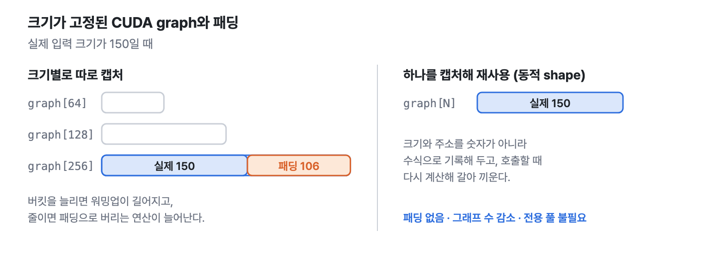

### 해법: 호스트 코드를 심볼릭으로 추적한다

커널을 띄우기 전에 CPU에서 도는 코드(호스트 코드)는 크기를 읽고, grid를 계산하고, 출력 텐서를 할당한다. 이 계산을 구체적인 숫자가 아니라 **수식**으로 기록해 두면, 크기가 바뀌었을 때 수식만 다시 평가해 그래프의 인자를 갈아 끼울 수 있다.

이를 위해 PyTorch 2의 컴파일러가 이미 쓰고 있는 **SymInt**(symbolic integer)를 가져온다. 값을 모르는 정수로 코드를 실행하면서, 그 위에서 일어난 계산을 기록하는 방식이다.

분기를 만나면 **가드**를 추가한다. 예를 들어 `if x.shape[0] > 4`에서 참 쪽으로 진행했다면 "크기가 5 이상"이라는 가드를 남긴다. 추적 결과는 분기가 없는 직선 경로와, 그 경로를 재사용해도 되는 조건의 묶음이 된다.

기존 CUDA graph가 불투명한 함수를 통째로 캡처했다면, 여기서는 입력을 명시적으로 넘긴다. 입력에서 가드와 수식을 유도하기 때문이다.

### 커널 종류별로 추적하는 방법

텐서는 크기, stride, 데이터 포인터로 분해할 수 있고 셋 다 정수다. 그래서 텐서를 심볼릭 정수만으로 표현할 수 있다.

| 커널                                | 추적 방법                                                                                                       | 사용자 코드 변경                           |
| ----------------------------------- | --------------------------------------------------------------------------------------------------------------- | ------------------------------------------ |
| **Triton**                          | 호스트 코드가 Python이다. 런처에 훅을 걸어 Triton이 넣은 가드를 읽고 grid 계산식을 추적한다.                    | 없음                                       |
| **CuTe DSL**                        | 호스트 코드가 MLIR로 컴파일된다. 생성된 MLIR을 해석하면서 수식 트리와 가드를 만든다.                            | 없음                                       |
| **CUDA C++**                        | 같은 방식으로 수식과 가드를 만든다.                                                                             | 크기와 포인터 타입을 int에서 SymInt로 변경 |
| **닫힌 라이브러리** (cuBLAS, cuDNN) | 소스가 없어 내부를 추적할 수 없다. 서로 다른 주소로 두 번 캡처하고 파라미터 바이트를 비교해 주소 위치를 찾는다. | 없음. 대신 입력 속성별로 캐시한다.         |

Triton을 예로 들면, Triton은 커널을 띄울 때 암묵적인 특수화를 넣는다. 크기가 16으로 나누어떨어지는지, 32비트 인덱싱이 가능한지 같은 조건이다. 이 조건이 바뀌면 Triton이 새 커널을 컴파일하므로 추적도 다시 해야 한다. 이런 조건이 그대로 가드가 된다. grid는 "원소 수를 1024로 나눈 올림" 같은 수식으로 남는다.

### 커널 수준 dispatch 가드

같은 연산이라도 입력에 따라 다른 커널을 고르는 경우가 있다. layer norm이 정렬 여부에 따라 다른 구현을 쓰는 식이다.

그런데 출력 텐서의 속성은 입력 크기만으로 정해진다. 어떤 구현을 고르든 그래프의 나머지 부분은 달라지지 않는다. 그래서 가드를 두 종류로 나눴다.

- 프로그램 전체의 추적이 유효한지를 정하는 가드
- 그 커널 하나만 바꾸면 되는지를 정하는 가드

나누지 않으면 한 곳의 변화가 그래프 전체를 무효로 만든다. 독립적인 layer norm이 k개 있고 각각 정렬 여부가 다를 수 있다면 가능한 그래프가 2^k개가 된다. 나누면 바뀐 커널만 교체하면 된다.

### 런타임: 호출 한 번에 일어나는 일

호출마다 아래 순서가 전부 C++에서 실행된다.

1. **입력 읽기**: 크기, stride, 포인터를 읽는다.
2. **가드 확인**: 실패하면 새 변형을 추적한다.
3. **수식 평가**: grid, 크기, 주소를 계산한다.
4. **데이터 포인터 할당**: 출력과 임시 텐서의 주소를 새로 받는다.
5. **바뀐 노드만 패치하고 그래프 실행**
6. **출력 감싸기**: 일반 텐서로 돌려준다.

여기서 따라오는 이득이 있다.

- 호출마다 새 주소를 받으니 전용 풀이 필요 없고, 입력을 복사할 필요도 없다.
- 중간값은 메모리만 받고 Tensor 객체는 만들지 않는다. 객체를 만들고 없애는 비용이 사라진다.
- 출력 텐서를 만드는 CPU 작업은 그래프를 실행시킨 뒤에 한다. GPU가 일하는 동안 CPU 작업이 뒤에 숨는다.

4번의 메모리 할당은 두 가지 중 고를 수 있다. eager 모드의 캐싱 할당기 로직을 재사용하거나, 메모리 플랜을 세워 한 번에 할당한다.

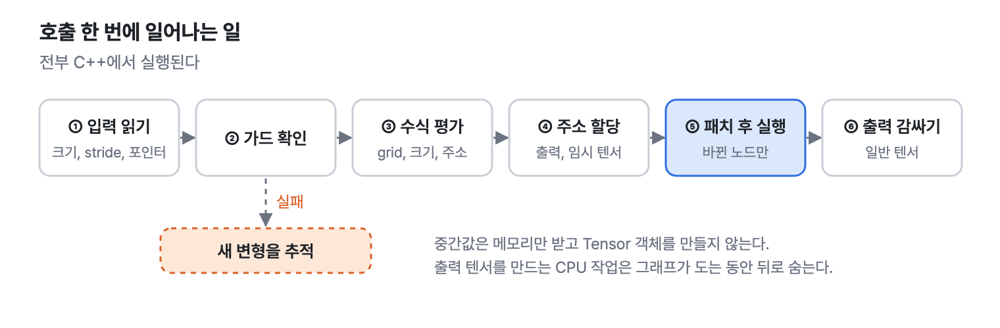

### 메모리 플래닝: 온라인과 오프라인

메모리 플래닝은 동적 shape와 별개로 쓸 수 있다. 한 번 캡처하면서 모든 할당과 해제를 기록하고, 배치를 계획한 다음, 계획된 메모리 영역으로 다시 캡처한다.

차이는 **언제 배치를 정하느냐**다.

- **온라인(eager)**: 텐서를 요청받는 순간 자리를 정해야 한다. 앞으로 어떤 텐서가 올지 모른다. 슬라이드 예시에서는 텐서 `f`가 연속된 3단위를 필요로 하는데, 남은 자리가 흩어진 빈틈뿐이라 맨 위에 새로 쌓였다. 총 9단위를 썼다.
- **오프라인(planned)**: 모든 텐서의 수명을 먼저 본 뒤 자리를 정한다. bin packing 같은 알고리즘을 쓸 수 있다. 같은 예시가 6단위로 끝났다. 6단위는 그 스텝에서 동시에 살아 있는 텐서의 최대치라 더 줄일 수 없다.

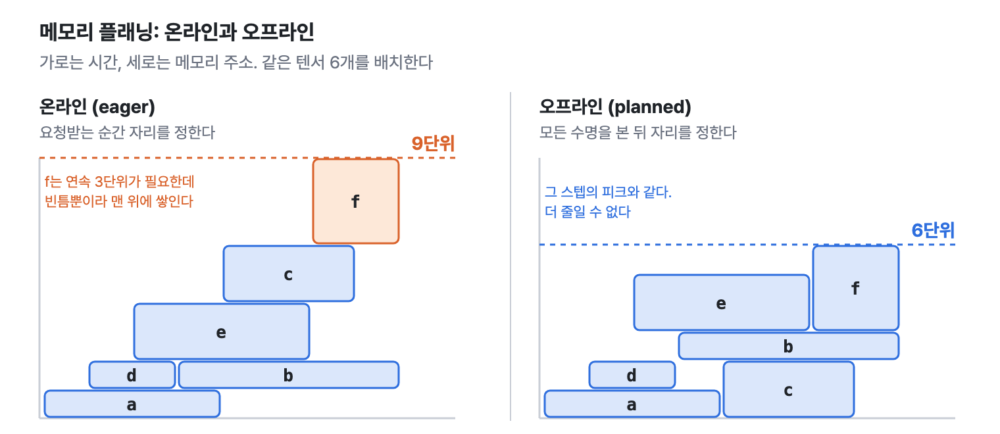

스트림 사이의 재사용도 달라진다. eager는 서로 다른 CUDA 스트림 사이에서 메모리를 재사용하지 않는다. 스트림을 여러 개 쓰는 분산 학습에서는 낭비가 생긴다. CUDA graph에서는 동기화 지점이 정확히 보이기 때문에 추가 동기화 없이 안전하게 재사용할 수 있다.

TorchTitan에서 DeepSeek V4 Flash를 학습하는 데 적용한 결과 같은 배치 크기에서 메모리가 12% 줄었다. 절반은 오프라인 플래닝에서, 절반은 스트림 간 재사용에서 나왔다. 아낀 메모리는 배치를 키우거나 activation checkpointing을 줄이는 데 쓸 수 있다.

### 결과

**연산 하나에도 적용할 수 있다.** 기존 CUDA graph는 프로그램 전체에 적용하지 않으면 메모리 단편화나 추가 캡처 비용을 치러야 했다. 동적 CUDA graph는 복사 비용도 메모리 비용도 없어서 연산 하나 단위로 도입할 수 있다. CPU 쪽 최적화를 여러 개 하는 대신 CUDA graph를 한 번 동작시키면 CPU 작업이 통째로 사라진다.

**기존 CUDA graph와 성능이 같거나 더 낫다.** 호출마다 수식을 평가하고 메모리를 새로 할당하는 추가 작업이 있는데도 성능은 동등했다. 입력을 풀로 복사하지 않아서 더 빠른 경우도 있었다.

**vLLM과 비교했다.** vLLM은 지금 "breakable CUDA graph"를 쓴다. decode는 전체를 캡처하고, prefill은 1024까지만 캡처하며, 특정 연산에서 그래프를 끊는다. 끊긴 곳마다 커널 실행 오버헤드가 붙는다.

| 구간          | 결과                                                                                |
| ------------- | ----------------------------------------------------------------------------------- |
| decode        | 동등하다. vLLM도 전체를 캡처하기 때문이다.                                          |
| prefill, 혼합 | 작은 크기에서 더 빠르다. 토큰 수가 커지면 GPU 연산이 지배적이 되어 차이가 사라진다. |
| 콜드 스타트   | 훨씬 빠르다. vLLM은 그래프를 천 개 단위로 캡처하고, 이쪽은 몇 개를 재사용한다.      |

메모리 단편화에 대한 설명도 있었다. eager 할당기와 CUDA graph가 반반 섞여 있을수록 단편화가 심해진다. 전부 CUDA graph이거나 전부 eager이면 단편화가 없다.

### 다음 단계

- 메모리 플래닝 그래프가 곧 들어온다. 학습 스텝 전체가 CUDA graph로 캡처되는 경우라면 쓰기를 권했다.
- 동적 shape CUDA graph는 upstream 방법을 논의하는 중이다.
- 이후 vLLM과 FlashInfer에 지원을 추가하고, `torch.compile`의 기본 런타임으로 만들 계획이다.

### 질의응답

**행렬 곱처럼 큰 연산에서는 효과가 줄지 않는가?**

CUDA graph로 아끼는 것은 "커널 실행 지연 × 커널 수"라는 상수다. 연산이 커질수록 이 절감은 상대적으로 작아진다. 그래도 학습 스텝 전체의 메모리 패턴을 알 수 있다는 점처럼 가속 외의 이유가 있다고 답했다.

**한 머신에 vLLM 서비스를 여러 개 띄울 때 도움이 되는가?**

전용 풀 없이 eager 풀을 그대로 쓰기 때문에 vLLM이 지금 수동으로 처리하는 메모리 재사용 문제가 줄어든다. 다만 추론에서 아끼는 메모리는 전용 풀 약 2GB 정도다. 추론에서 이 기술을 쓰는 주된 이유는 메모리가 아니라 가속이고, 메모리 절감은 학습에서 더 크다.

**실패한 뒤 복구하는 시간도 줄일 수 있는가?**

명시적으로 다루지는 않았지만 할 수 있는 일이라고 답했다. Foundry, vLLM, SGLang이 CUDA graph를 직렬화해 저장하고 다시 불러오는 방식으로 이 문제를 이미 잘 풀고 있어서 발표에서는 깊이 다루지 않았다고 했다.

## 3. Attention Gym

발표자는 Driss Guessous다. Meta PyTorch 팀에서 GPU 커널, 그중 attention과 저정밀도 연산을 맡고 있고 FlexAttention을 만든 사람 중 한 명이다.

한 줄로 줄이면 **"attention 변형이 너무 빨리 늘어나니, PyTorch 본체가 아니라 빠르게 움직이는 별도 라이브러리에서 커널을 지원한다"** 는 발표였다.

### Attention Gym이 무엇이 됐나

[Attention Gym](https://github.com/meta-pytorch/attention-gym)은 원래 FlexAttention 예제를 모아 두던 저장소다. FlexAttention은 attention 변형을 커널을 새로 짜지 않고 Python 함수로 표현하게 해 주는 PyTorch API다. 누가 누구를 볼 수 있는지를 정하는 `mask_mod`와 attention 점수를 바꾸는 `score_mod` 두 가지로 causal, sliding window, ALiBi 같은 변형을 만든다. 저장소 이름은 여기에 빗댄 농담이다.

지금은 성격이 바뀌고 있다. 최근 공개된 모델들이 새로운 attention을 들고 나왔기 때문이다.

- GDN(Gated Delta Rule), KDA(Kimi Delta Attention) 같은 linear attention
- DeepSeek의 sparse attention, compressed sparse attention
- MLA

변형마다 학습, prefill, decode, context parallel 단계별로 전용 커널이 필요하다. 전부 빠르게 구현하기는 어렵고, PyTorch 본체의 속도로는 따라갈 수 없다. 그래서 별도 저장소에서 한다. 12주 동안 16번 릴리스했다고 한다.

대가는 안정성이다. 빨리 움직이고 호환성도 깨뜨리니 의존성 버전을 고정해서 쓰라고 했다. 1번 세션이 "한 번 빌드하면 계속 돌아간다"는 약속이었던 것과 정반대의 선택인데, 다루는 층이 다르기 때문이다.

### 연산 하나에 구현 세 가지

Kimi K3에 쓰이는 chunk KDA를 예로 저장소의 구조를 설명했다.

| 구현                     | 설명                                                                                                                              |
| ------------------------ | --------------------------------------------------------------------------------------------------------------------------------- |
| **reference**            | 순수 PyTorch로 작성했다. 매우 느려서 실제로 쓰면 안 된다. CPU에서 돌고 autograd를 지원하며, 연산의 수치 동작을 정의하는 기준이다. |
| **fused (Triton)**       | Triton이 지원하는 백엔드라면 어디서나 돌아간다. 기대할 만한 성능과 메모리 특성을 낸다.                                            |
| **warpdrive (CuTe DSL)** | Blackwell 이후의 최신 GPU 전용이다. 가장 빠르다.                                                                                  |

바퀴를 다시 만들지는 않는다고 했다. MLA나 일부 sparse attention은 flash-attention에 이미 좋은 구현이 있어서 그것을 가져다 쓴다.

### 커널을 직접 갖고 있으면 수치 보장을 넣을 수 있다

커널을 직접 만들면 벤더 라이브러리가 주지 않는 보장을 넣을 수 있다. 대표적인 것이 **batch invariance**다. 같은 시퀀스라면 배치의 어느 위치에 있든, 옆에 어떤 요청이 함께 있든 같은 결과가 나오는 성질이다.

기존 커널은 이를 보장하지 않는다. cuBLAS의 행렬 곱은 한때 이 성질을 지켰지만 한 릴리스 뒤에는 지키지 않게 됐다고 한다.

강화학습에서는 이 성질이 중요하다. 학습하는 쪽과 생성하는 쪽의 결과가 어긋나면 문제가 되기 때문이다. 실제로 TorchTitan의 비트 단위 일치 테스트가 깨진 일이 있었고, 원인은 테스트가 암묵적으로 batch invariance에 의존하고 있었다는 것이었다. 그래서 이를 정식 API로 만들었다. 필요하면 옵션을 켜고 버전을 고정해 두면 이후에도 보장한다.

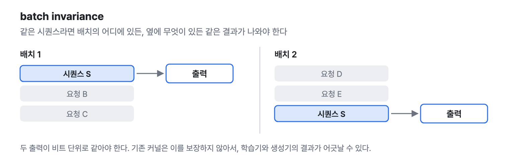

### warpdrive: warp마다 역할을 나눈다

Blackwell 세대 커널의 목표는 **텐서 코어를 쉬지 않게 하는 것**이다. 텐서 코어가 병목이라면 하드웨어를 잘 쓰고 있다는 뜻이다.

이를 위한 패턴이 warp specialization이다. warp는 GPU에서 함께 실행되는 스레드 32개의 묶음이다. 한 블록 안의 warp들에게 서로 다른 역할을 맡겨 파이프라인을 만든다. 행렬 곱 커널이라면 이렇게 나뉜다.

1. **load**: 전역 메모리에서 입력을 읽어 온다.
2. **MMA**: 텐서 코어로 곱한다.
3. **epilogue**: 결과를 저장한다.

단계 사이는 여러 칸짜리 버퍼로 이어져 있다. 읽는 쪽이 앞서 채워 두면 곱하는 쪽은 기다리지 않고 계속 일할 수 있다.

문제는 이 사이의 동기화다. 틀리기 쉽고, 틀렸을 때의 결과가 나쁘다. 운이 좋으면 데드락이 나서 문제가 있다는 걸 알게 된다. 운이 나쁘면 오류 없이 값만 틀린다. 모델이 틀린 수치로 조용히 학습된다.

warpdrive는 이 동기화를 선언으로 바꾼다. "깊이가 3인 링 버퍼이고, 한쪽은 로더, 다른 쪽은 텐서 코어"라고 적으면 대기 횟수, 위상 추적, 메모리 할당과 해제를 warpdrive가 처리한다. 새 언어는 아니고 NVIDIA의 CuTe DSL 위에 올린 방언이다.

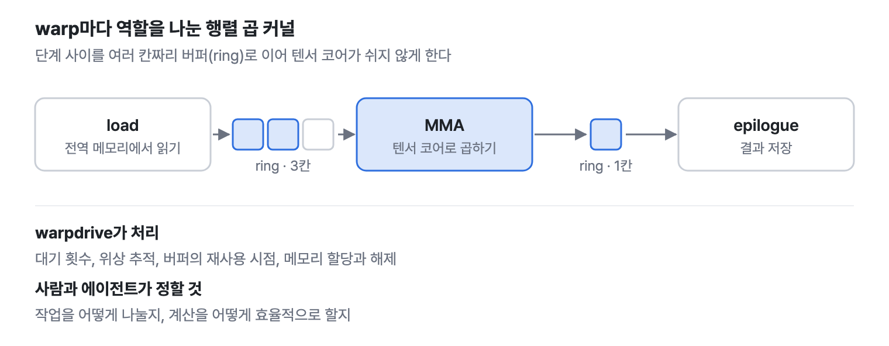

### 정답이 하나인 일은 언어에 넣는다

발표자가 "내 지론"이라며 내놓은 주장이다.

> 올바른 방법이 하나뿐인 일이라면 에이전트가 매번 생성하게 두지 말고 언어 자체에 넣어야 한다.

동기화가 그런 일이다. 이것을 언어가 맡으면 에이전트는 정말 탐색해야 할 곳에 시간을 쓴다. 작업을 어떻게 나눌지, 계산을 어떻게 더 효율적으로 할지, 수치적 성질을 어떻게 지킬지다.

사람에게도 이득이다. 리뷰할 때 동기화를 덜 봐도 된다. `describe()`를 호출하면 커널의 파이프라인 구조를 그려 주는데, 발표자는 이 그림에서 의존 관계가 빡빡한 곳을 찾아 새 구조를 시도한다고 했다.

### 결과

**cuDNN 커널을 다시 썼다.** 가장 빠른 GDN, KDA 커널은 cuDNN 쪽에서 나오는데 약 6만 줄이다. 발표자가 읽어 본 것 중 가장 복잡한 커널이라고 했다. 이것을 warpdrive로 다시 쓴 결과는 이렇다.

- 더 빨라졌다.
- 실제 동기화 버그 4개를 찾았다. 그중 하나는 오류가 전혀 나지 않으면서 수치만 틀리는 경쟁 상태였다.
- 하루 반 정도 걸렸다.

**메가 커널을 만들었다.** Qwen3 소형 모델 전체를 커널 하나로 만들어 GB300에서 초당 약 2,000토큰을 냈다. 아침에 에이전트에게 시켜 놓고 체육관에 다녀오니 완성돼 있었다고 한다.

**학습이 빨라졌다.** 커널 계열 하나를 바꾼 것만으로 end-to-end 학습이 60% 빨라졌다.

context parallelism 이야기도 있었다. 긴 시퀀스를 여러 GPU에 나눠 처리하는 방식인데, GPU 수를 늘릴 때 거의 선형으로 확장됐다. 이 작업을 할 때는 2번 세션의 동적 CUDA graph가 아직 없었기 때문에, 학습 그래프 하나를 캡처해 다른 크기로 재생할 수 있도록 커널을 직접 설계해야 했다고 한다.

형태가 정리되면 이런 기능을 PyTorch 본체로 옮길 계획이다.

### 질의응답

**에이전트를 어떻게 쓰는가?**

특별한 건 없다고 답했다. 모델마다 잘하는 일이 달라 나눠 쓴다. 코드 작성과 리뷰를 서로 다른 모델에게 맡긴다. CuTe DSL 작성 방식과 warpdrive에 대한 스킬을 많이 만들어 뒀다.

새 커널은 병렬화 방식부터 정한다. 텐서 코어가 사이클당 얼마, 전역 메모리 로드가 얼마 걸리는지로 상한을 먼저 계산해 구조를 설계한다. 그다음에 서브에이전트에게 맡긴다. warpdrive에는 커널 내부 프로파일러가 들어 있다. "측정하지 않으면 빠르게 만들 수 없다"고 했다.

**소비자용 GPU에서도 쓸 수 있는가?**

쓸 수 있지만 Triton 구현을 써야 한다. 가장 빠른 구현은 Blackwell의 TMEM이라는 메모리에 의존한다. linear attention은 상태를 들고 다니는데, 보통의 커널은 이를 매번 전역 메모리로 돌려보낸다. TMEM에 상태를 둘 공간이 딱 맞게 있어서 그대로 이어 갈 수 있다는 것이 요령이라고 했다.

**벤치마크가 특정 워크로드에만 맞춰지지 않았는지 어떻게 확인하는가?**

메가 커널을 예로 들었다. 처음에는 배치 1, 토큰 1개, GPU 1개 조건에서만 빨랐다. 혼자 쓰기에는 충분하지만 실제로는 아무도 그렇게 쓰지 않는다.

커널은 원래 한 곳에서만 좋다가 점점 넓혀 가는 식으로 자란다고 했다. FlexAttention을 손으로 쓸 때도 그랬다. 지금은 만드는 속도가 빨라져서 그 불균형이 더 눈에 띌 뿐이다.

**스킬과 하네스를 공유할 수 있는가?**

팀의 작업은 전부 오픈소스로 공개돼 있다. 다만 개인 스킬과 하네스는 공개하지 않는다. 이유를 묻자 "계속 고용돼 있고 싶어서"라고 농담했다.

## 4. PyTorch at Frontier: From kernels to clusters

발표자는 Sherlock Huang이다. Meta에서 TorchTitan을 맡고 있다. 제목은 넓지만 내용은 TorchTitan 안의 **GraphTrainer** 소개였다.

한 줄로 줄이면 **"학습 스텝 전체를 그래프 하나로 캡처하고, 최적화는 그 그래프 위에서 따로 한다"** 는 발표였다.

### GraphTrainer란

과정은 세 단계다.

1. **캡처**: forward, loss, backward를 한 번에 추적해 그래프 하나를 얻는다. 계산뿐 아니라 GPU 사이의 통신도 이 그래프에 들어간다.
2. **최적화**: 그래프를 고쳐 쓰는 함수인 그래프 패스를 차례로 적용한다.
3. **실행**: 최적화된 그래프를 실행한다.

2번 세션의 CUDA graph가 GPU 커널의 실행 순서를 기록한 것이라면, 여기서 말하는 그래프는 그보다 위 단계다. 텐서 연산 수준에서 학습 스텝 전체를 기록한 FX 그래프다.

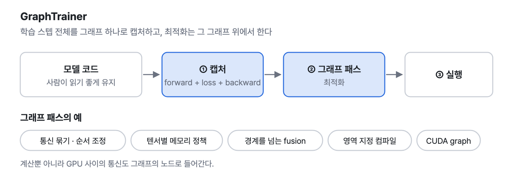

### 왜 그래프인가

이유로 세 가지를 들었다.

**하드웨어가 다양해졌다.** GPU가 아닌 칩은 하드웨어로 내려보내기 위해 그래프를 요구하는 경우가 많다. 그래프가 있으면 여러 하드웨어를 겨냥할 수 있다.

**조합이 단순해진다.** eager 모드에서 FSDP, activation checkpointing, `torch.compile`을 함께 쓰면 서로 부딪히는 일이 많다. 그래프에서는 전부 그래프 패스이고, 지켜야 할 약속은 그래프 형식 하나뿐이다.

여기에 에이전트 이야기가 붙는다. 모델 코드와 최적화 코드를 분리한다는 것이 그래프의 원래 장점인데, 이제 그 분업이 더 분명해졌다고 했다. 사람은 모델 코드를 읽기 좋게 유지하고, 에이전트는 그래프 위에서 최적화 패스를 만든다.

**성능이 나온다.** eager에서 커스텀 커널은 코드를 읽기 좋게 유지하려면 모듈 하나 안에 머문다. 그래프에는 모듈 경계가 없다.

### 단순한 추적기를 골랐다

PyTorch에는 추적기가 세 세대 있었다. TorchScript, FX tracer, 그리고 `torch.compile`이 쓰는 Dynamo다. GraphTrainer는 일부러 더 단순한 `make_fx` 기반 추적으로 돌아갔다.

처음에는 Dynamo로 시작했다고 한다. 그런데 문제가 생겼을 때 원인을 찾기 어려웠다. 학습은 매 스텝 같은 계산을 반복하기 때문에 단순한 추적기가 요구하는 조건을 이미 만족한다. 그래서 단순한 쪽이 충분했다.

파라미터와 버퍼는 그래프의 입력으로 올린다. 그래프 안에는 상태가 없다.

추적할 때 코드 블록을 컨텍스트 매니저로 감싸 태그를 붙일 수 있다. 그 안에서 만들어진 노드에 태그가 남아서, 나중에 그래프 패스가 "이 영역"을 찾아 조작할 수 있다. 뒤의 여러 기능이 이 장치에 기댄다.

### 통신이 그래프 안에 보인다

FSDP는 가중치를 여러 GPU에 쪼개 두었다가 필요할 때 모으는 방식이다. 쓰기 직전에 all-gather로 모으고, backward 뒤에 reduce-scatter로 gradient를 다시 나눈다.

eager의 FSDP2는 이 통신을 모듈 훅으로 구현한다. 모듈에 들어갈 때와 나올 때 몰래 끼어드는 코드라서 추적하기 어렵다.

GraphTrainer가 쓰는 SimpleFSDP는 가중치에 접근하는 순간 통신이 일어나도록 구현했다. 그래서 all-gather와 reduce-scatter가 그래프 안의 노드로 나타난다.

이전에는 통신이 여러 곳에 흩어져 있었다. FSDP는 모듈 훅에, tensor parallel이나 context parallel은 사용자 코드에 있었다. 이제는 한곳에서 전부 보이고, 보이기 때문에 옮길 수 있다.

### 텐서마다 메모리 정책을 고른다

backward를 하려면 forward의 중간값(activation)이 필요하다. 이를 전부 들고 있으면 메모리가 모자란다. 그래프에서는 텐서 하나하나에 대해 셋 중 하나를 고른다.

| 선택        | 방법                                                      | 비용   |
| ----------- | --------------------------------------------------------- | ------ |
| **저장**    | GPU 메모리에 그대로 둔다.                                 | 메모리 |
| **재계산**  | forward에서 버리고, backward에서 필요할 때 다시 계산한다. | 연산   |
| **offload** | CPU 메모리로 내보냈다가 필요할 때 다시 가져온다.          | 전송   |

eager에서는 이 선택을 모듈 단위로 해야 했다. 그래프에서는 모듈 경계에 묶이지 않는다. 예를 들어 앞쪽 레이어의 텐서만 offload할 수 있다. 앞쪽 레이어는 backward에서 가장 늦게 쓰이니 다녀올 시간이 넉넉하다.

구현은 전부 그래프 패스다. 재계산은 forward의 해당 부분을 복사해 backward 쪽에 붙이고 연결을 바꾸는 작업이다. offload는 `offload`와 `reload` 노드 한 쌍을 끼워 넣는 작업이고, 이 노드의 위치를 옮겨 다른 작업과 겹쳐 실행되게 할 수 있다.

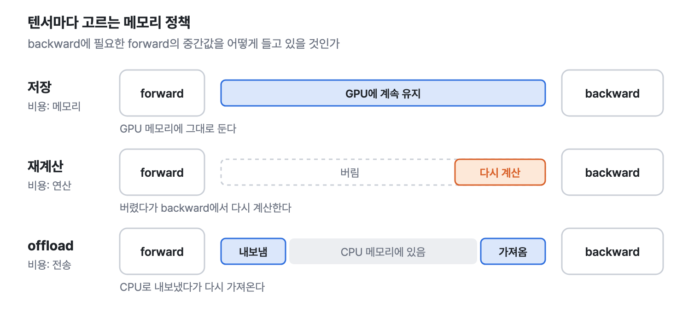

### eager의 경계를 넘는 fusion

fusion은 연산 여러 개를 커널 하나로 합치는 것이다. 메모리를 읽고 쓰는 횟수가 줄어 빨라진다. 그래프에서만 쉽게 되는 fusion 세 가지를 보여 줬다.

| 종류            | 예                                                 | eager에서 어려운 이유                                          |
| --------------- | -------------------------------------------------- | -------------------------------------------------------------- |
| **모듈 간**     | attention 끝의 norm + residual + FFN 앞의 norm     | 서로 다른 모듈에 있어 코드를 옮겨야 한다.                      |
| **레이어 간**   | FFN의 출력 행렬 곱 + residual + 다음 레이어의 norm | 코드에서는 루프라서 N번째와 N+1번째를 합칠 수 없다.            |
| **backward 안** | 행렬 곱의 backward + norm의 backward               | autograd function을 직접 정의하고 커널을 꽂아야 해서 번거롭다. |

그래프에서는 루프가 풀려 레이어가 전부 펼쳐져 있고, backward도 노드로 드러나 있다.

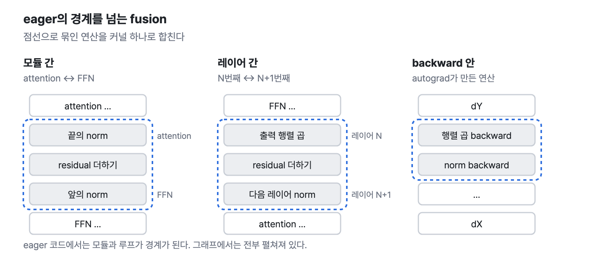

### 수치를 지키면서 컴파일한다

컴파일러(Inductor)는 자잘한 fusion 기회를 자동으로 잡아 준다. 문제는 수치다. 그래프 전체에 적용하면 더하는 순서가 바뀌어 결과가 미세하게 달라진다. LLM 학습에서는 이런 변화를 꺼린다.

그래서 사용자가 **컴파일할 영역을 직접 지정**한다. 앞에서 말한 태그로 영역을 감싸면 그 부분만 Inductor로 컴파일한다. 결과가 비트 단위로 같거나 허용 오차 안이라는 것을 확인한 영역에만 적용하면 된다.

3번 세션에서도 수치 보장이 중요한 주제였다. 속도만큼이나 "결과가 바뀌지 않는다"는 점을 중요하게 다루는 것이 이날 발표들의 공통점이었다.

### 통신 스케줄링

통신이 그래프의 노드이니 스케줄링은 노드를 옮기는 일이 된다. 미리 가져오고 싶으면 통신 노드를 몇 칸 앞으로 옮기면 된다.

expert parallel의 backward를 예로 들었다. expert로 보내고 받는 통신이 있는데, 모듈 경계에서 FSDP 훅이 끼어들어 이전 레이어의 reduce-scatter와 다음 레이어 가중치의 prefetch를 함께 실행한다. 주의하지 않으면 전부 같은 순간에 몰려 대역폭을 놓고 다툰다. 그래프에서는 이들을 겹치지 않게 벌려 놓을 수 있다.

### 한 번만 컴파일한다

규모가 커지면 컴파일 시간이 문제가 된다. 그대로 두면 모든 GPU 프로세스가 각자 같은 추적과 최적화를 반복한다.

그래서 한 곳에서만 컴파일하고 결과물을 전체에 배포한다. 결과물이 특정 프로세스에 의존하지 않도록, 통신 그룹 같은 값은 심볼로 남겨 두었다가 나중에 채운다.

장애 복구에도 쓰인다. 학습 도중 GPU가 죽어 재시작해야 할 때, 다시 컴파일하지 않고 결과물을 불러오기만 하면 된다.

### GraphPP

pipeline parallelism은 모델을 여러 스테이지로 잘라 서로 다른 GPU에 두고, 마이크로배치를 흘려보내는 방식이다. "모두가 좋아하고 모두가 무서워한다"고 소개했다.

GraphPP는 그래프를 스테이지별 서브그래프로 자른다. 그리고 **스케줄을 액션의 나열로 표현**한다. "스테이지 i의 forward를 마이크로배치 j에 대해 실행", "스테이지 i의 가중치를 모은다", "다음 스테이지로 출력을 보낸다" 같은 액션이다. 런타임은 이 나열을 그대로 재생한다.

스케줄이 데이터가 되니, 어떤 순서로 무엇을 겹쳐 실행할지를 바꿔 가며 실험하기 쉽다.

### 결과

GB300 256장으로 학습한 결과를 보여 줬다.

- GPU당 초당 약 5,500토큰을 처리했다.
- 몇 주 동안 손으로 최적화한 eager 구현과 성능이 같다.
- loss 곡선이 eager와 비트 단위로 일치한다.
- 기준선은 Megatron이 제출한 최고 MLPerf 성능이고, 그와 같은 수준이다.

프로파일러 트레이스, 학습 로그, loss 곡선을 모두 공개했다. 자신의 트레이스와 나란히 놓고 어디서 차이가 나는지 볼 수 있다.

다른 하드웨어 이야기도 있었다.

- **Google TPU**: TPU 팀과 협업해 통합했다. TPU는 모든 것을 그래프로 받아야 해서 optimizer까지 그래프에 넣었다. 최대 8,000 TPU 규모에서 MFU 29%를 기록했다.
- **AWS Trainium**: PyTorch 팀과 상의 없이 AWS가 독자적으로 통합했다. 나중에 알고 놀랐다고 한다.

### 에이전트가 그래프를 최적화한다

마지막은 발표자가 지금 탐색하고 있다는 방향이었다. 에이전트에게 모델 코드나 인프라 코드가 아니라 **그래프를 최적화하게** 한다.

1. 학습 스텝 전체의 그래프를 준다.
2. 에이전트가 그래프 변환을 제안한다.
3. 변환을 적용해 실행하고, 벤치마크와 프로파일을 얻는다.
4. **더 빠르고 수치가 맞으면** 유지한다.
5. 반복한다.

그래프가 구조화돼 있고 변환의 올바름을 검증할 수 있어서, 성능 최적화가 탐색 문제가 된다.

슬라이드에는 Llama3 8B를 H100 8장으로 학습한 실험이 있었다. 최적화 패스가 하나도 없는 상태가 약 4,480 TPS, 사람이 만든 프로덕션 패스가 7,162 TPS다. 에이전트의 탐색 중 가장 좋은 경로는 7,525 TPS까지 올라갔다. 사람이 만든 것보다 약 5% 높다. 하룻밤 사이에 모델이 10% 빨라진 사례도 있다고 했다.

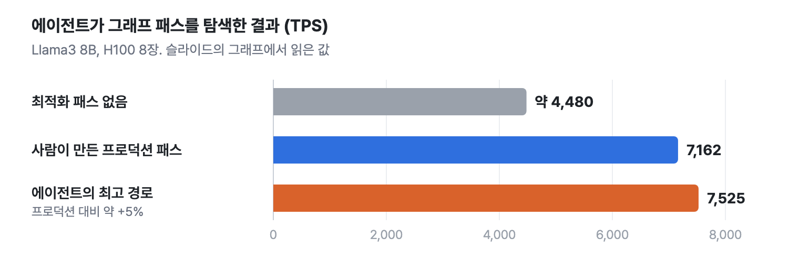

3번 세션의 "정답이 하나인 일은 언어에 넣는다"와 같은 방향이다. 에이전트가 다룰 대상을 구조화하고, 틀렸는지 확인할 수단을 함께 준다.

### 질의응답

**`torch.compile`과 무엇이 다른가?**

`torch.compile`은 보통 트랜스포머 블록을 통째로 감싸 컴파일러에 넘긴다. 사용자 피드백에 따르면 너무 한 덩어리라서 세밀하게 제어하기 어렵다.

GraphTrainer는 컴파일러를 여러 부품으로 쪼개 필요한 것만 조합해 쓰게 한다. 수치 변화가 싫으면 수치가 보존되는 영역에만 컴파일을 적용한다. 추적기도 다르다. `torch.compile`은 Dynamo를, GraphTrainer는 더 단순한 `make_fx`를 쓴다.

**에이전트의 최적화를 eager와 그래프에서 비교해 봤는가?**

해 봤다고 답했다. fusion 기회를 **찾는 것**은 차이가 없었다. 프로파일러 결과를 주면 에이전트는 느린 커널을 eager 코드로든 그래프 노드로든 되짚어 간다.

차이는 **적용**에 있었다. eager에서는 코드를 다시 써야 하고, 모듈 경계를 넘으면 코드를 옮겨야 한다. 그래프에서는 그래프 패스 하나를 추가하면 된다.

eager에서 에이전트가 놓친 경우도 있었다. 재계산 뒤에 backward가 이어지는 패턴이다. eager에서는 backward도 재계산도 코드에 드러나 있지 않아 에이전트가 추론해야 한다. 그래프에서는 전부 노드다. 다만 에이전트가 더 좋아지면 큰 차이가 아닐 수 있다고 덧붙였다.

## 5. vLLM TorchTPU

발표자는 Tiezhen Wang이다. vLLM을 만든 회사 Inferact에서 생태계를 맡고 있고, 이전에는 Hugging Face와 TensorFlow 팀에 있었다.

한 줄로 줄이면 **"Google TPU로 오픈소스 모델을 서빙하려는데 decode가 느렸고, 레이어의 연산을 전부 커널 하나로 합친 메가커널로 풀었다"** 는 발표였다.

### TPU가 밖으로 나오고 있다

TPU는 Google이 설계한 전용 칩이다. 원래 Google 바깥에서 쓰도록 만든 것이 아니다. 발표자가 TensorFlow 팀에 있을 때 Google 안에서는 대규모 학습과 서빙에 잘 쓰였지만, 외부 개발자가 쓸 수 있는 상태는 아니었다고 한다.

최근 Google이 방향을 바꿨다. 오픈소스 모델을 서빙하려는 개발자에게도 TPU를 제공한다. TPU가 NVIDIA GPU보다 저렴해서 오픈 모델을 서빙할 때 총비용이 낮아진다는 분석도 소개했다.

소프트웨어도 따라가고 있다. 예전에는 TPU에서 JAX만 쓸 수 있었는데, PyTorch를 쓸 수 있게 하는 **TorchTPU**가 만들어지고 있다. Inferact는 여기에 vLLM을 묶어 **vLLM TorchTPU**를 만든다. 4번 세션에서 TorchTitan의 GraphTrainer가 TPU에 통합됐다는 이야기가 학습 쪽이었다면, 이쪽은 추론 쪽이다.

### 가장 어려운 모델부터

첫 대상으로 작은 모델이 아니라 가장 어려운 모델을 골랐다. Kimi K3다.

- 파라미터가 2.8조 개다. 4비트로 줄여도 가중치를 담는 데만 메모리 1.4TB가 필요하다.
- 컨텍스트 윈도우가 100만 토큰이라 KV cache도 메모리를 많이 쓴다.
- 가중치가 MXFP4 형식으로 공개됐는데 TPU는 이 형식을 지원하지 않는다. 내려받아 그대로 올리면 동작하지 않는다.

우선 돌아가게 만들었다. 그런데 같은 vLLM을 NVIDIA GB200에서 돌린 것보다 토큰 생성 속도가 크게 뒤졌다. TPU 팀의 말로는 TPU v7이 GB200과 비슷한 성능이어야 했다. 그래서 차이가 어디서 나는지 찾았다.

### 느린 건 계산이 아니라 메모리 이동이었다

커널 내부를 프로파일링해 보니 예상과 달랐다. 계산은 시간이 얼마 걸리지 않았다. 대부분의 시간은 **데이터를 옮기는 데** 쓰이고 있었다.

연산 하나는 이런 순서로 진행된다.

1. 칩 바깥의 메모리(HBM)에서 가중치 행렬을 읽어 칩 안의 빠른 메모리(SRAM)에 올린다.
2. 계산한다.
3. 결과를 다시 쓴다.

decode는 배치가 작고 한 번에 토큰 하나만 만든다. 계산량 자체가 적으니 1번과 3번이 시간을 다 차지한다. 전날 로컬 추론 엔진 세션에서 "토큰 하나를 만들 때마다 가중치 전체를 메모리에서 읽어야 한다"며 양자화로 읽을 양을 줄였던 것과 같은 병목이다.

### 메가커널

메모리 이동이 병목이라면 메모리 파이프라인이 쉬지 않게 하면 된다. 그런데 커널이 나뉘어 있으면 할 수 없다. 커널마다 "읽고, 계산하고, 쓰고"를 끝내야 다음으로 넘어가기 때문이다.

그래서 레이어의 연산을 전부 **커널 하나**로 합쳤다. 이것이 메가커널이다. 경계가 없으니 메모리 로드를 원하는 시점 어디에나 넣을 수 있다. 예를 들어 다른 장치와 결과를 주고받는 동안 다음 레이어의 가중치를 미리 읽어 온다.

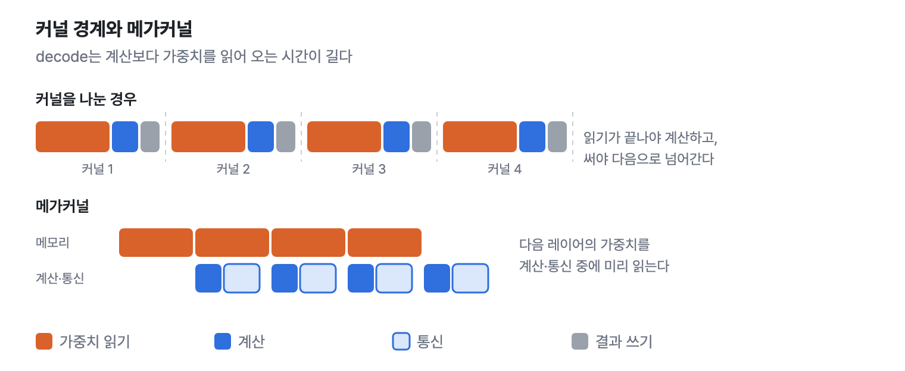

3번 세션에서 warpdrive가 커널 _안에서_ 읽기와 계산을 겹치게 했다면, 메가커널은 그 범위를 커널 *사이*로 넓힌 것이다. 3번 세션의 발표자도 Qwen3 소형 모델을 GPU용 메가커널로 만들어 보였다.

### TPU에서는 왜 쉬운가

메가커널은 새로운 개념이 아니다. 다만 GPU에서 제대로 만들기가 어렵다. 발표자는 TPU에서는 쉽다며 이유 두 가지를 들었다.

| 구분            | GPU                                                               | TPU                                               |
| --------------- | ----------------------------------------------------------------- | ------------------------------------------------- |
| 칩 안의 메모리  | 연산 유닛(SM)마다 작은 메모리가 따로 있다.                        | 큰 메모리(VMEM)가 있다. 하나가 64MB다.            |
| 데이터 배치     | 어느 유닛에 둘지 정해야 하고, 유닛 사이에 결과를 주고받아야 한다. | 가중치 행렬을 통째로 올린다.                      |
| 프로그래밍 모델 | 멀티스레드다. warp를 어떻게 나눌지 직접 설계한다.                 | 단일 스레드처럼 보인다. 병렬화는 하드웨어가 한다. |

3번 세션은 GPU에서 warp마다 역할을 나누고 그 사이의 동기화를 맞추는 일이 얼마나 어려운지에 대한 이야기였다. TPU에서는 그 문제가 프로그래머에게 보이지 않는다.

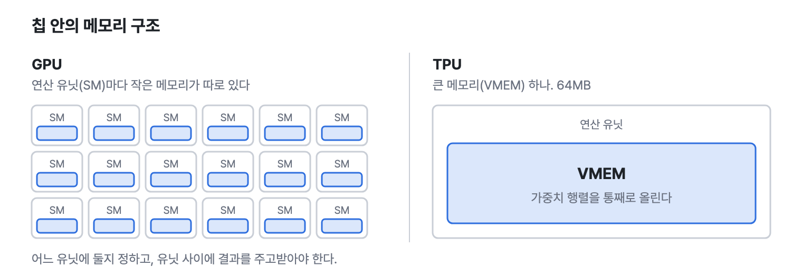

### 결과

메가커널로 TPU v7에서 2~4배 빨라졌고, GB200과 같은 수준에 도달했다.

코드는 [Inferact/tpu-megakernels](https://github.com/Inferact/tpu-megakernels)에 공개돼 있다. 저장소의 설명에 따르면 speculative decoding을 함께 쓴 Kimi K3에서 TPU v7 16개로 초당 709토큰, GB200 16개로 452토큰이 나왔다.

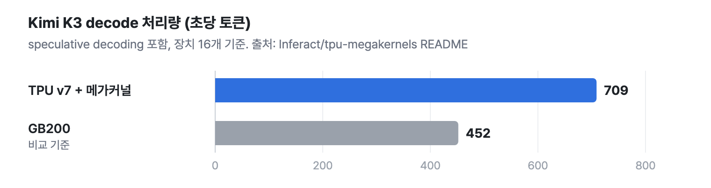

메가커널이 푸는 것은 decode뿐이다. decode는 메모리가 병목이고 prefill은 계산이 병목이라 성격이 다르다. 실제 서빙에는 prefill, speculative decoding, 요청 스케줄링이 더 필요하다. 그래서 메가커널을 vLLM TorchTPU에 넣어 vLLM의 나머지 구성 요소를 재사용한다.

TPU가 없는 사람을 위해 Google과 함께 커뮤니티 풀을 운영한다고도 했다. 제안서를 내면 심사해서 사용 기회를 준다.

### 질의응답

**GPU에서 TPU로 옮겼더니 레이어별 값과 최종 logit에 작은 차이가 있다. 고려한 적이 있는가?**

가능한 일이라고 답했다. NVIDIA에서 쓰는 4비트 형식이 TPU에서는 지원되지 않고, TPU에서는 커널을 합치기 때문에 결과가 달라질 수 있다. 하드웨어가 달라 비트 단위로 일치시킬 수는 없다. Kimi K3를 옮길 때는 벤치마크를 돌려 품질 저하가 허용 범위 안인지 확인했다고 한다.

같은 하드웨어 안에서 비트 단위 일치를 지키려던 3번, 4번 세션과 대비되는 답이었다. 하드웨어를 넘어가면 기준이 "같은 값"에서 "같은 품질"로 바뀐다.

**AMD GPU 지원은 어느 정도 진행됐는가?**

AMD와도 협업하고 있다. AMD도 메가커널과 비슷한 것을 하고 있고 mono kernel이라고 부른다. 공개 벤치마크 대시보드를 띄워 놓고, NVIDIA의 최신 세대가 가장 앞서 있지만 TPU와 AMD도 이미 그 앞 세대와 비슷한 수준이라고 설명했다.

## 덧붙임: TorchTitan

2번과 3번 세션에서 TorchTitan이 계속 나와서 따로 정리해 봤다.

[TorchTitan](https://github.com/pytorch/torchtitan)은 PyTorch 팀이 만든 대규모 생성 모델 학습 플랫폼이다. PyTorch의 분산 학습 기능을 실제 규모에서 어떻게 조합하는지 보여 주는 기준 구현에 가깝다.

- **여러 병렬화를 조합한다.** FSDP, tensor parallel, pipeline parallel, context parallel, expert parallel을 모델 코드를 고치지 않고 함께 쓴다.
- **사전학습부터 강화학습까지 한 곳에서 한다.** 사전학습, 파인튜닝, 그리고 TitanRL이라는 강화학습 스택이 같은 모델 정의를 공유한다. 3번 세션의 batch invariance가 필요했던 곳이 TitanRL이다.
- **최신 공개 모델을 지원한다.** Llama, Qwen, DeepSeek, Kimi, gpt-oss, FLUX 등의 모델 정의가 들어 있다.
- **읽고 고치기 쉽게 만들었다.** 학습 설정 하나가 Python 함수 하나라서, 설정을 바꾸려면 함수를 새로 쓰면 된다.

이날 세션들과의 관계는 이렇다.

| 세션                         | TorchTitan과의 관계                                                             |
| ---------------------------- | ------------------------------------------------------------------------------- |
| 2. Dynamic Shape CUDA Graphs | 메모리 플래닝의 12% 절감을 TorchTitan 학습에서 측정했다.                        |
| 3. Attention Gym             | TorchTitan이 가장 중요한 사용자다. 커널과 수치 보장의 요구사항이 여기서 나온다. |
| 4. PyTorch at Frontier       | TorchTitan 안의 GraphTrainer가 주제다.                                          |

새 기능을 TorchTitan에서 먼저 검증하고, 형태가 잡히면 PyTorch 본체로 옮기는 흐름이다.

## 마무리

다섯 세션을 관통한 건 **경계를 없애는 일**이었다.

- 2번 세션은 커널과 커널 사이에 끼어 있던 CPU 작업을 없앴다(CUDA graph).
- 4번 세션은 모듈과 레이어의 경계를 없애고 학습 스텝 전체를 한 그래프로 봤다(GraphTrainer).
- 5번 세션은 커널의 경계를 없애 메모리 로드를 아무 데나 끼워 넣을 수 있게 했다(메가커널).

경계가 있으면 그 안에서만 최적화할 수 있다. 경계를 없애면 통신과 계산을 겹치고, 미리 읽어 오고, 멀리 떨어진 연산을 합칠 수 있다.

반대로 1번 세션은 **경계를 세우는 일**이었다. PyTorch와 확장 사이에 바뀌지 않는 ABI를 두어 서로 독립적으로 움직이게 했다. 실행 경로에서는 경계를 지우고, 프로젝트 사이에서는 경계를 단단히 세운다.

**수치 보장**도 계속 나왔다. 3번 세션의 batch invariance, 4번 세션의 비트 단위로 일치하는 loss 곡선과 영역 지정 컴파일이 그랬다. 빠르게 만드는 것만큼이나 결과가 바뀌지 않게 하는 데 공을 들이고 있었다.

**에이전트**도 빠지지 않았다. 3번 세션은 틀리기 쉬운 동기화를 언어에 넣어 에이전트가 계산에 집중하게 했고, 4번 세션은 그래프를 에이전트가 최적화할 대상으로 삼았다. 두 발표 모두 에이전트에게 구조화된 대상과 검증 수단을 함께 주는 방향이었다.

마지막으로 **NVIDIA 밖의 하드웨어**다. 1번 세션의 가속기 공통 스트림 API, 4번 세션의 TPU와 Trainium 통합, 5번 세션의 TPU 서빙이 모두 같은 흐름 위에 있었다.

PyTorch 생태계에도 기여해 보고 싶다는 생각이 있었는데, 사실 잘 아는 분야가 아니다 보니 이번 기회에 좀 더 친해지고 싶어서 참여했다. 덕분에 많은 부분을 알아볼 수 있었다. 나중에 기회가 되면 직접 기여해 볼 수 있기를 기대한다.
