이번에 파이토치 행사에 참여해서 [딥러닝을 위한 파이토치 입문](https://product.kyobobook.co.kr/detail/S000000555687) 책을 받았다.

최신 책은 아니지만, 그래도 딥러닝과 파이토치에 대한 이해를 높일 수 있을 거라 기대하며 책의 목차를 뼈대로 삼아 딥러닝 개발 흐름을 빠르게 한 바퀴 훑는다

책 내용을 담지 않고 필요한 키워드와 주제만 골라 AI로 정리한다.

## 딥러닝 시작하기

### 인공지능, 머신러닝, 딥러닝

세 용어는 포함 관계입니다. 인공지능 안에 머신러닝이 있고, 머신러닝 안에 딥러닝이 있습니다.

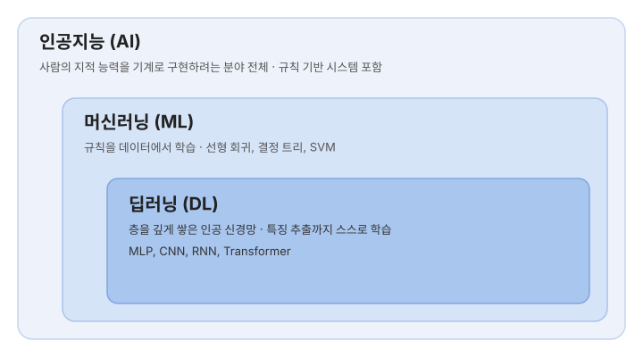

- **인공지능(AI)**: 사람의 지적 능력(추론, 인식, 판단)을 기계로 구현하려는 분야 전체를 가리킵니다. 사람이 규칙을 일일이 써넣는 규칙 기반 시스템도 여기에 들어갑니다.
- **머신러닝(ML)**: 규칙을 사람이 쓰지 않고 데이터에서 학습하게 하는 방법입니다. 선형 회귀, 결정 트리, SVM 등이 있습니다.
- **딥러닝(DL)**: 머신러닝 중에서 층을 깊게 쌓은 인공 신경망을 쓰는 방법입니다.

| 구분            | 규칙은 누가 만드나 | 특징(feature)은 누가 뽑나 |
| --------------- | ------------------ | ------------------------- |
| 규칙 기반 AI    | 사람               | 사람                      |
| 전통적 머신러닝 | 모델이 학습        | 사람이 설계               |
| 딥러닝          | 모델이 학습        | 모델이 학습               |

머신러닝과 딥러닝을 가르는 지점은 특징 추출입니다. 전통적 머신러닝은 "이미지에서 윤곽선을 뽑아 입력으로 쓰자"처럼 사람이 특징을 설계해야 했습니다. 딥러닝은 원본 데이터를 그대로 넣으면 층을 거치면서 필요한 특징까지 스스로 학습합니다. 그 대신 데이터와 연산량이 훨씬 많이 필요합니다.

### 인공 신경망

인공 신경망(Artificial Neural Network)은 뇌의 뉴런 연결 구조에서 착안한 모델입니다. 기본 단위인 노드(뉴런) 하나는 다음 계산을 합니다.

1. 입력 각각에 가중치를 곱해서 모두 더하고 편향을 더합니다. `z = w·x + b`
2. 그 값을 활성화 함수에 통과시켜 출력을 냅니다. `y = f(z)`

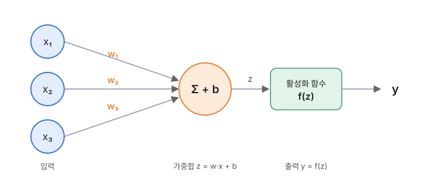

이 노드를 여러 개 묶은 것이 층(layer)이고, 층을 이어 붙인 것이 신경망입니다.

- **입력층**: 데이터를 받습니다.
- **은닉층**: 입력을 변환하면서 특징을 추출합니다. 은닉층이 여러 개면 심층 신경망(DNN)이라 부르고, 딥러닝의 "딥"이 이 깊이를 뜻합니다.
- **출력층**: 최종 예측값을 냅니다.

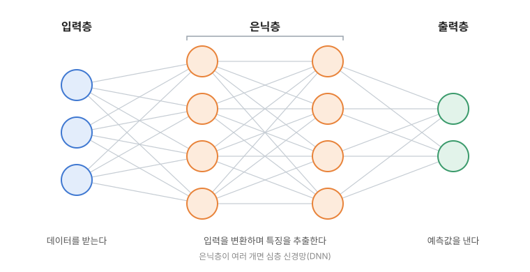

학습이란 예측이 정답에 가까워지도록 가중치와 편향을 조정하는 과정입니다. 활성화 함수가 비선형이어야 층을 쌓는 의미가 있습니다. 선형 함수만 쓰면 몇 층을 쌓아도 결국 하나의 선형 변환과 같아지기 때문입니다.

### 퍼셉트론과 역전파

#### 퍼셉트론

퍼셉트론은 1957년 프랭크 로젠블랫이 제안한 가장 단순한 인공 신경망으로, 노드 하나로 이루어진 이진 분류기입니다. 가중합이 기준값을 넘으면 1, 아니면 0을 출력합니다.

학습 규칙도 단순합니다. 예측이 틀렸을 때만 오차만큼 가중치를 고칩니다.

```
w ← w + η (y − ŷ) x
```

여기서 `y`는 정답, `ŷ`는 예측, `η`는 학습률입니다.

한계는 직선(초평면) 하나로 나눌 수 있는 문제만 풀 수 있다는 점입니다. 1969년 민스키와 페퍼트가 단층 퍼셉트론은 XOR 문제를 풀 수 없음을 보였고, 이후 신경망 연구가 한동안 침체됩니다.

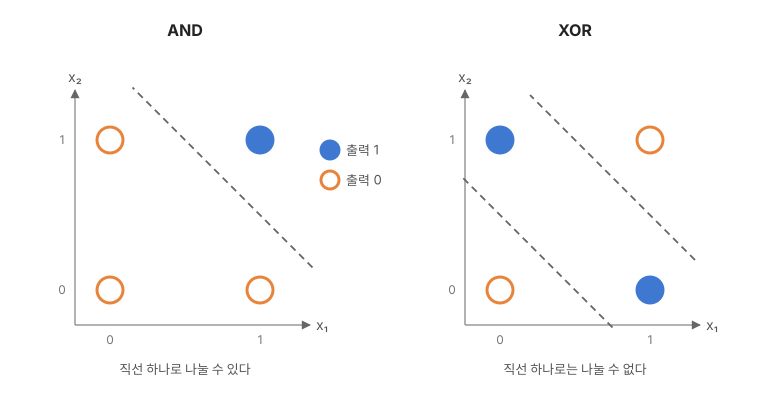

층을 여러 개 쌓은 다층 퍼셉트론(MLP)은 XOR을 풀 수 있습니다. 그런데 퍼셉트론 학습 규칙은 정답과 직접 비교할 수 있는 출력층에만 쓸 수 있어서, 은닉층의 가중치를 어떻게 학습시킬지가 문제로 남았습니다.

#### 역전파

역전파(backpropagation)가 이 문제를 풉니다. 1986년 루멜하트, 힌턴, 윌리엄스의 논문으로 널리 알려졌습니다.

1. **순전파**: 입력을 넣어 출력층까지 계산하고 예측값을 얻습니다.
2. **손실 계산**: 예측과 정답의 차이를 손실 함수로 구합니다.
3. **역전파**: 손실을 각 가중치로 미분한 값(기울기)을 출력층에서 입력층 방향으로 거슬러 가며 구합니다. 연쇄 법칙(chain rule)을 써서 뒤쪽 층에서 구한 값을 앞쪽 층 계산에 재사용합니다.
4. **가중치 갱신**: 경사하강법으로 기울기의 반대 방향으로 가중치를 조금 옮깁니다. `w ← w − η · ∂L/∂w`

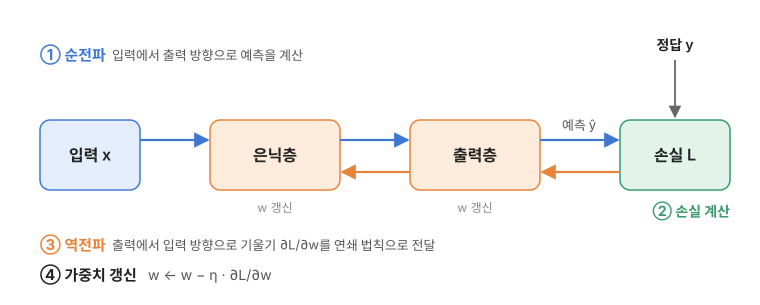

이 과정을 반복하면 손실이 줄어듭니다. 역전파는 기울기를 구하는 방법이고, 그 기울기로 가중치를 실제로 고치는 것은 경사하강법 같은 최적화 기법의 몫입니다.

연쇄 법칙을 쓰려면 미분이 가능해야 하므로, 퍼셉트론의 계단 함수 대신 시그모이드나 ReLU 같은 활성화 함수를 씁니다. 파이토치에서는 `loss.backward()`가 3번을, `optimizer.step()`이 4번을 수행합니다.

---

## 지도 학습

### 지도 학습이란

지도 학습(supervised learning)은 입력과 정답(라벨)이 짝지어진 데이터로 모델을 학습시키는 방법입니다. 모델은 입력 `x`를 받아 예측 `ŷ`를 내고, 정답 `y`와의 차이(손실)가 줄어드는 방향으로 가중치를 고칩니다. 이렇게 학습한 모델로 처음 보는 입력의 정답을 맞히는 것이 목표입니다.

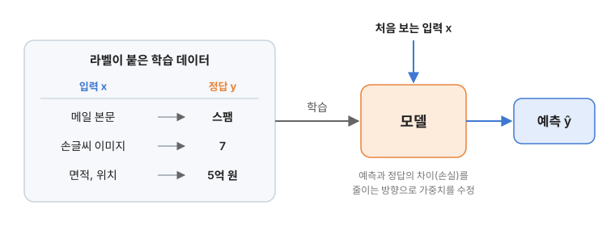

학습 방식은 정답이 어떻게 주어지느냐로 나뉩니다.

| 구분        | 정답(라벨)                 | 예                     |
| ----------- | -------------------------- | ---------------------- |
| 지도 학습   | 있음                       | 이미지 분류, 집값 예측 |
| 비지도 학습 | 없음                       | 군집화, 오토인코더     |
| 강화 학습   | 없음. 행동의 보상으로 학습 | 게임, 로봇 제어        |

지도 학습은 성능이 잘 나오지만 라벨을 사람이 붙여야 해서 데이터를 만드는 비용이 큽니다.

### 회귀와 분류

지도 학습은 정답의 형태에 따라 두 가지로 나뉩니다.

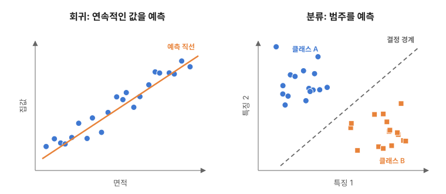

| 구분           | 회귀(regression)       | 분류(classification)    |
| -------------- | ---------------------- | ----------------------- |
| 정답           | 연속적인 숫자          | 정해진 범주 중 하나     |
| 예             | 집값, 기온, 주가       | 스팸 여부, 숫자 인식    |
| 출력층         | 노드 1개, 값을 그대로  | 클래스 수만큼, Softmax  |
| 주요 손실 함수 | MSE, MAE               | Cross Entropy           |
| 평가 지표      | RMSE, MAE              | 정확도, 정밀도, 재현율  |

분류는 범주가 둘이면 이진 분류, 셋 이상이면 다중 분류라고 부릅니다. 같은 신경망이라도 회귀냐 분류냐에 따라 출력층과 손실 함수가 달라집니다.

### 데이터 세트 분할

모델은 학습에 쓴 데이터를 외워버릴 수 있습니다. 그래서 학습에 쓴 데이터로 성능을 재면 실제보다 좋게 나옵니다. 처음 보는 데이터에서의 성능(일반화 성능)을 알려면 데이터를 미리 나눠 두어야 합니다.

- **학습(train) 세트**: 가중치를 학습하는 데 씁니다.
- **검증(validation) 세트**: 학습 중간에 성능을 확인합니다. 학습률이나 층 수 같은 하이퍼파라미터를 고르고, 학습을 언제 멈출지 정하는 데 씁니다.
- **평가(test) 세트**: 모든 결정이 끝난 뒤 최종 성능을 한 번 잽니다.

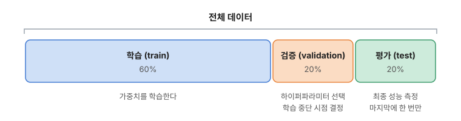

검증 세트와 평가 세트를 따로 두는 이유가 있습니다. 검증 성능을 보면서 모델을 계속 고치면 모델이 검증 세트에 맞춰지므로, 그 수치는 더 이상 공정한 평가가 아닙니다. 평가 세트는 모델 선택에 한 번도 쓰지 않아야 합니다.

비율은 보통 8:1:1이나 6:2:2로 나눕니다. 데이터가 아주 많으면 검증과 평가 비율을 더 줄여도 됩니다.

나눌 때 주의할 점은 다음과 같습니다.

- **섞어서 나눈다**: 데이터가 클래스 순서로 정렬돼 있으면 한쪽 세트에 특정 클래스만 몰립니다. 분류에서는 클래스 비율을 유지하며 나누는 층화 추출(stratify)을 씁니다.
- **시계열은 섞지 않는다**: 미래 데이터로 과거를 예측하게 되므로 시간 순서대로 앞쪽을 학습, 뒤쪽을 평가에 씁니다.
- **데이터 누수를 막는다**: 정규화에 쓰는 평균과 표준편차는 학습 세트에서만 구하고, 그 값을 검증과 평가 세트에 그대로 적용합니다.

학습 손실은 계속 줄어드는데 검증 손실이 다시 올라가기 시작하면 과적합입니다. 데이터가 적어서 검증 세트를 떼기 아까울 때는 교차 검증을 씁니다.

```python
from sklearn.model_selection import train_test_split

# 먼저 평가 세트를 떼고, 남은 것을 학습과 검증으로 나눈다 (6:2:2)
X_tmp, X_test, y_tmp, y_test = train_test_split(X, y, test_size=0.2, stratify=y, random_state=42)
X_train, X_val, y_train, y_val = train_test_split(X_tmp, y_tmp, test_size=0.25, stratify=y_tmp, random_state=42)
```

---

## 파이토치 기본

### 텐서

텐서(tensor)는 숫자를 담는 다차원 배열이고, 파이토치의 모든 데이터와 가중치가 텐서로 표현됩니다. 넘파이 배열과 거의 같지만 두 가지가 다릅니다. GPU에서 연산할 수 있고, 미분에 필요한 연산 기록을 남길 수 있습니다.

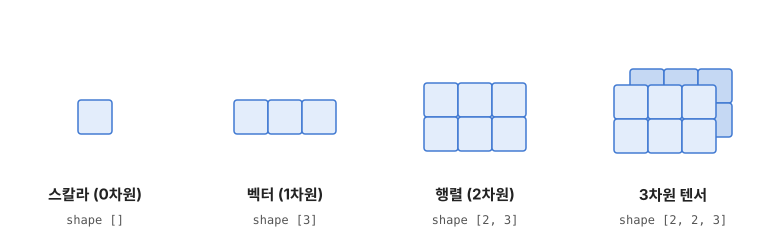

#### 만들기

```python
import torch
import numpy as np

torch.zeros(2, 3)          # 0으로 채운 2x3
torch.ones(2, 3)           # 1로 채운 2x3
torch.rand(2, 3)           # 0~1 균등 분포
torch.randn(2, 3)          # 표준 정규 분포
torch.arange(0, 10, 2)     # tensor([0, 2, 4, 6, 8])

torch.tensor([[1, 2], [3, 4]])   # 리스트에서 (복사)
arr = np.array([1.0, 2.0])
torch.tensor(arr)                # 넘파이에서 (복사)
torch.from_numpy(arr)            # 넘파이에서 (메모리 공유)
```

`torch.from_numpy`는 메모리를 공유하므로 한쪽을 바꾸면 다른 쪽도 바뀝니다.

#### 크기, 타입, 연산

```python
x = torch.rand(2, 3)
x.shape     # torch.Size([2, 3])
x.dtype     # torch.float32
x.device    # cpu

a = torch.tensor([[1., 2.], [3., 4.]])
b = torch.tensor([[5., 6.], [7., 8.]])
a + b       # 원소별 덧셈
a * b       # 원소별 곱셈
a @ b       # 행렬 곱 (torch.matmul)
a.sum(), a.mean(dim=0)   # 전체 합, 열 방향 평균
```

기본 타입은 실수가 `float32`, 정수가 `int64`입니다. 넘파이의 실수 기본형은 `float64`라서 넘파이에서 넘어온 텐서는 `.float()`로 맞춰 줘야 하는 경우가 많습니다. 타입이나 장치(CPU, GPU)가 다른 텐서끼리 연산하면 오류가 납니다.

#### 크기 변환

```python
x = torch.arange(6)    # shape [6]
x.view(2, 3)           # [2, 3]
x.reshape(3, -1)       # [3, 2]. -1은 나머지에서 자동 계산
x.unsqueeze(0)         # [1, 6]. 크기 1인 차원 추가
x.view(1, 6).squeeze() # [6]. 크기 1인 차원 제거
```

`view`는 메모리를 그대로 두고 모양만 바꾸기 때문에 메모리가 연속적일 때만 쓸 수 있습니다. `reshape`는 필요하면 복사해서라도 바꿔 주므로 헷갈리면 `reshape`를 쓰면 됩니다. `permute`나 `transpose`는 차원의 순서를 바꾸는 연산이라 `view`와 결과가 다릅니다.

#### 넘파이와 파이썬 값으로 되돌리기

```python
x = torch.tensor([1.0, 2.0])
x.numpy()                      # 넘파이 배열 (메모리 공유)
x.sum().item()                 # 원소가 하나인 텐서 → 파이썬 숫자 3.0

y.detach().cpu().numpy()       # 기울기를 추적 중이거나 GPU에 있는 텐서
```

손실 값을 기록할 때는 `loss.item()`을 씁니다. `loss`를 그대로 리스트에 쌓으면 연산 기록까지 함께 붙들고 있어서 메모리가 계속 늘어납니다.

### 자동 미분

역전파에 필요한 기울기를 파이토치가 대신 구해 주는 기능이 자동 미분(autograd)입니다. `requires_grad=True`인 텐서로 연산하면 파이토치가 연산 과정을 계산 그래프로 기록해 두고, `backward()`를 부르면 그래프를 거꾸로 따라가며 기울기를 구합니다.

```python
x = torch.tensor(2.0, requires_grad=True)
y = x ** 2 + 3 * x

y.backward()    # dy/dx 계산
x.grad          # tensor(7.) → 2x + 3 = 7
```

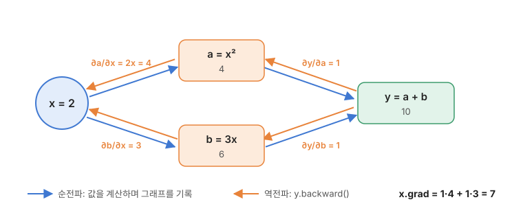

기억해 둘 점은 세 가지입니다.

- **기울기는 누적된다**: `backward()`를 부를 때마다 `.grad`에 더해집니다. 그래서 매 반복마다 `optimizer.zero_grad()`로 비워 줍니다.
- **`backward()`는 스칼라에서 부른다**: 손실처럼 값이 하나인 텐서에서 호출합니다.
- **추적이 필요 없으면 끈다**: 평가할 때는 `with torch.no_grad():` 안에서 계산해 메모리와 시간을 아낍니다.

#### 선형 회귀로 보는 학습 루프

`y = 2x + 1`에 잡음을 섞은 데이터에서 `w`와 `b`를 찾습니다.

```python
x = torch.linspace(0, 1, 100).unsqueeze(1)
y = 2 * x + 1 + 0.1 * torch.randn_like(x)

w = torch.zeros(1, requires_grad=True)
b = torch.zeros(1, requires_grad=True)
optimizer = torch.optim.SGD([w, b], lr=0.1)

for epoch in range(1000):
    pred = x * w + b                   # 순전파
    loss = ((pred - y) ** 2).mean()    # 손실 (MSE)

    optimizer.zero_grad()              # 기울기 초기화
    loss.backward()                    # 역전파
    optimizer.step()                   # 가중치 갱신

print(w.item(), b.item())              # 2와 1에 가까운 값
```

순전파, 손실 계산, `zero_grad`, `backward`, `step`으로 이어지는 이 다섯 줄은 모델이 아무리 복잡해져도 그대로입니다.

### 데이터 불러오기

파이토치는 데이터를 두 단계로 다룹니다. `Dataset`은 샘플 하나를 꺼내는 방법을 정의하고, `DataLoader`는 그것을 배치로 묶고 섞어서 학습 루프에 넘겨줍니다.

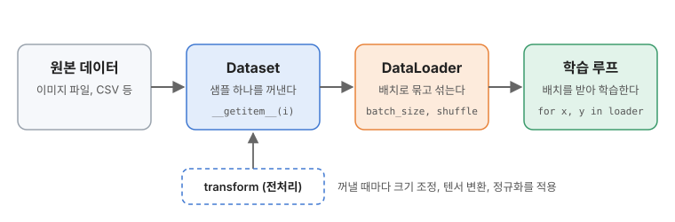

#### 제공되는 데이터 세트와 전처리

`torchvision.datasets`에 MNIST, CIFAR-10 같은 데이터 세트가 들어 있습니다. 전처리는 `transforms`로 정의해서 넘깁니다.

```python
import torchvision
import torchvision.transforms as transforms
from torch.utils.data import DataLoader

transform = transforms.Compose([
    transforms.Resize(32),
    transforms.ToTensor(),                                    # [0, 255] HWC → [0, 1] CHW 텐서
    transforms.Normalize((0.5, 0.5, 0.5), (0.5, 0.5, 0.5)),   # 채널별 (값 - 평균) / 표준편차
])

trainset = torchvision.datasets.CIFAR10(root='./data', train=True, download=True, transform=transform)
trainloader = DataLoader(trainset, batch_size=32, shuffle=True)

images, labels = next(iter(trainloader))
images.shape    # torch.Size([32, 3, 32, 32]) → [배치, 채널, 높이, 너비]
```

학습용은 `shuffle=True`로 매 에폭마다 섞고, 검증과 평가용은 섞지 않습니다.

#### 폴더로 정리된 이미지

이미지가 클래스별 폴더에 나뉘어 있으면 `ImageFolder`가 폴더 이름을 라벨로 삼아 읽어 줍니다.

```
data/train/cat/001.jpg
data/train/dog/001.jpg
```

```python
trainset = torchvision.datasets.ImageFolder(root='./data/train', transform=transform)
trainset.class_to_idx    # {'cat': 0, 'dog': 1}
```

#### 커스텀 데이터 세트

그 밖의 형태는 `Dataset`을 상속해서 직접 만듭니다. 메서드 세 개만 구현하면 됩니다.

```python
from torch.utils.data import Dataset

class MyDataset(Dataset):
    def __init__(self, x_data, y_data, transform=None):
        self.x_data = x_data
        self.y_data = y_data
        self.transform = transform

    def __len__(self):                  # 전체 샘플 수
        return len(self.x_data)

    def __getitem__(self, idx):         # idx번째 샘플 하나
        x, y = self.x_data[idx], self.y_data[idx]
        if self.transform:
            x = self.transform(x)
        return x, y

loader = DataLoader(MyDataset(x_data, y_data), batch_size=32, shuffle=True)
```

전처리도 직접 만들 수 있습니다. `transform`은 샘플을 받아 변환한 샘플을 돌려주는 호출 가능한 객체면 되므로, `__call__`을 구현한 클래스를 만들어 `transforms.Compose` 안에 파이토치 제공 전처리와 섞어 넣으면 됩니다.

```python
class AddNoise:
    def __init__(self, std=0.1):
        self.std = std

    def __call__(self, x):
        return x + self.std * torch.randn_like(x)

transform = transforms.Compose([transforms.ToTensor(), AddNoise(0.05)])
```

---

## 인공 신경망

5장부터는 코드 분량이 많아서 글에는 개념만 적고, 코드는 따로 저장소에 정리했습니다.

- 저장소: [dev-jonghoonpark/introduction-to-pytorch](https://github.com/dev-jonghoonpark/introduction-to-pytorch)
- 교재의 예제를 현재 파이토치 버전(2.15)에 맞춰 다시 썼습니다. 노트북 대신 셀 구분자(`# %%`)가 들어간 파이썬 스크립트라서 그대로 실행할 수도 있고 VS Code에서 셀 단위로 실행할 수도 있습니다.
- 각 절 끝의 "코드" 링크가 해당 예제 파일을 가리킵니다.
- 규모가 큰 예제 다섯 개(GAN, 깊은 K-평균, 의사 라벨링, MAML, 은닉 유체 메카니즘)는 [빈 파일에서 시작해 한 조각씩 쌓아 가는 단계별 해설](https://dev-jonghoonpark.github.io/introduction-to-pytorch/)을 따로 만들었습니다. 단계마다 바뀐 코드와 그 코드를 실제로 돌린 결과를 함께 보여 줍니다.

### 다층 퍼셉트론

가장 단순한 모델은 선형 회귀입니다. 입력에 가중치를 곱하고 편향을 더한 `y = Wx + b`가 전부이고, 파이토치에서는 `nn.Linear` 한 층에 해당합니다. 직선(초평면) 하나로 표현할 수 있는 관계만 배울 수 있습니다.

다층 퍼셉트론(MLP)은 이 선형 층을 여러 개 쌓고 층 사이에 비선형 활성화 함수를 끼운 모델입니다. 은닉층이 있어서 곡선 형태의 복잡한 관계도 근사할 수 있습니다. 모든 노드가 다음 층의 모든 노드와 연결되므로 완전 연결(fully connected) 신경망이라고도 부릅니다.

파이토치에서 모델은 `nn.Module`을 상속한 클래스로 만듭니다. `__init__`에서 층을 정의하고 `forward`에서 데이터가 층을 통과하는 순서를 적습니다. 학습은 4장의 루프(순전파, 손실 계산, `zero_grad`, `backward`, `step`)를 그대로 씁니다.

교재는 집값 예측을 예제로 씁니다. 특징 13개를 입력으로 받아 가격 하나를 내는 회귀 문제이고, 평가는 RMSE로 합니다.

> 코드: [01_linear_regression.py](https://github.com/dev-jonghoonpark/introduction-to-pytorch/blob/master/ch05_mlp/01_linear_regression.py), [02_house_price_mlp.py](https://github.com/dev-jonghoonpark/introduction-to-pytorch/blob/master/ch05_mlp/02_house_price_mlp.py)

### 활성화 함수

선형 층만 쌓으면 몇 층이든 하나의 선형 변환과 같습니다. 층 사이에 비선형 함수를 넣어야 깊이가 의미를 갖고, 그 비선형 함수가 활성화 함수입니다.

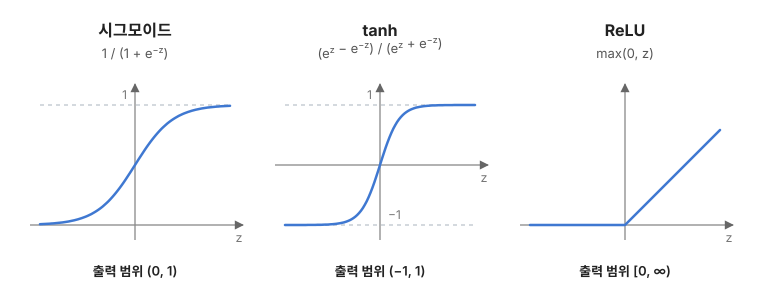

| 함수     | 출력 범위        | 특징                                                       | 주로 쓰는 곳           |
| -------- | ---------------- | ---------------------------------------------------------- | ---------------------- |
| 시그모이드 | (0, 1)         | 입력이 크거나 작으면 기울기가 0에 가까워진다               | 이진 분류의 출력       |
| tanh     | (−1, 1)          | 0이 중심이라 시그모이드보다 학습이 잘 되지만 같은 문제가 있다 | RNN 내부               |
| ReLU     | [0, ∞)           | 양수에서 기울기가 1이라 깊은 망에서도 기울기가 잘 전달된다 | 은닉층의 기본 선택     |
| Softmax  | (0, 1), 합이 1   | 여러 값을 확률 분포로 바꾼다                               | 다중 분류의 출력       |

시그모이드와 tanh는 양 끝에서 기울기가 거의 0이 됩니다. 역전파는 층마다 기울기를 곱해 나가므로, 층이 깊어지면 앞쪽 층에 전달되는 기울기가 사라집니다. 이것이 기울기 소실 문제이고, ReLU가 은닉층의 표준이 된 이유입니다.

ReLU에도 약점이 있습니다. 입력이 음수면 기울기가 0이라 한번 꺼진 노드가 다시 살아나지 못할 수 있습니다. 음수 구간에 작은 기울기를 주는 LeakyReLU, 매끄러운 곡선으로 바꾼 GELU와 SiLU(Swish)가 이를 보완한 변형입니다. 트랜스포머 계열은 GELU를 주로 씁니다.

출력층의 활성화 함수는 문제에 따라 정합니다. 회귀는 활성화 함수 없이 값을 그대로 내고, 이진 분류는 시그모이드, 다중 분류는 Softmax를 씁니다.

> 코드: [03_activations.py](https://github.com/dev-jonghoonpark/introduction-to-pytorch/blob/master/ch05_mlp/03_activations.py)

### 손실 함수

손실 함수는 예측이 정답에서 얼마나 벗어났는지를 숫자 하나로 나타냅니다. 학습은 이 값을 줄이는 과정입니다.

| 손실 함수     | 식                         | 특징                                            | 파이토치              |
| ------------- | -------------------------- | ----------------------------------------------- | --------------------- |
| MAE           | 평균 \|y − ŷ\|             | 이상치에 덜 민감하다                            | `nn.L1Loss`           |
| MSE           | 평균 (y − ŷ)²              | 큰 오차에 더 큰 벌을 준다. 회귀의 기본 선택     | `nn.MSELoss`          |
| Cross Entropy | −Σ y·log(ŷ)                | 정답 클래스의 예측 확률이 낮을수록 커진다. 분류의 기본 선택 | `nn.CrossEntropyLoss` |

`nn.CrossEntropyLoss`는 내부에서 Softmax를 함께 계산합니다. 그래서 모델의 출력층에는 Softmax를 넣지 않고 원래 값(logits)을 그대로 넘겨야 합니다. Softmax를 한 번 더 넣으면 오류 없이 돌아가지만 학습이 잘 되지 않습니다.

그 밖에 이진 분류에는 `nn.BCEWithLogitsLoss`, MSE와 MAE의 절충인 `nn.HuberLoss`가 자주 쓰입니다.

> 코드: [04_loss_functions.py](https://github.com/dev-jonghoonpark/introduction-to-pytorch/blob/master/ch05_mlp/04_loss_functions.py)

### 최적화 기법

역전파로 구한 기울기를 써서 가중치를 실제로 고치는 방법이 최적화 기법(optimizer)입니다.

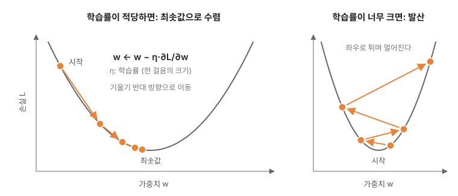

기본은 경사하강법입니다. 기울기의 반대 방향으로 학습률만큼 이동합니다. 전체 데이터로 기울기를 한 번 구하면 정확하지만 느리므로, 실제로는 데이터를 작은 묶음(미니배치)으로 나눠 묶음마다 가중치를 고칩니다. 이것이 확률적 경사하강법(SGD)입니다.

학습률은 가장 중요한 하이퍼파라미터입니다. 너무 작으면 학습이 느리고, 너무 크면 최솟값을 지나쳐 발산합니다.

SGD를 개선한 기법들은 두 가지 아이디어를 조합합니다.

- **모멘텀**: 이전에 이동하던 방향을 일부 유지합니다. 진동이 줄고 얕은 골짜기를 빠르게 지나갑니다.
- **적응적 학습률**: 가중치마다 학습률을 다르게 줍니다. 기울기가 계속 컸던 가중치는 조금씩, 작았던 가중치는 크게 움직입니다. AdaGrad와 RMSprop이 여기에 속합니다.

Adam은 둘을 합친 기법이고 학습률을 세밀하게 조정하지 않아도 잘 동작해서 가장 널리 쓰입니다. AdamW는 Adam에서 가중치 감쇠(weight decay)를 분리해 올바르게 적용한 것으로, 지금은 AdamW가 기본 선택입니다.

교재가 소개하는 MADGRAD는 2021년 메타(당시 페이스북)가 발표한 기법으로, 모멘텀과 적응적 학습률을 이중 평균(dual averaging) 방식으로 결합합니다. 파이토치에 내장돼 있지 않고 별도 패키지로 설치해야 합니다.

#### 스케줄링

학습률을 학습 내내 고정하지 않고 시간에 따라 바꾸는 것을 스케줄링이라 합니다. 처음에는 크게 움직여 빠르게 접근하고, 뒤로 갈수록 작게 움직여 세밀하게 맞춥니다.

- **StepLR**: 정해진 에폭마다 일정 비율로 줄입니다.
- **CosineAnnealingLR**: 코사인 곡선을 따라 부드럽게 줄입니다.
- **ReduceLROnPlateau**: 검증 손실이 더 줄지 않으면 줄입니다.
- **워밍업**: 처음 몇 에폭은 학습률을 0 근처에서 서서히 올립니다. 큰 모델에서 초반 학습을 안정시킵니다.

> 코드: [05_optimizers_schedulers.py](https://github.com/dev-jonghoonpark/introduction-to-pytorch/blob/master/ch05_mlp/05_optimizers_schedulers.py)

### 교차 검증

데이터가 적으면 검증 세트를 어떻게 떼느냐에 따라 평가 점수가 크게 달라집니다. K-겹 교차 검증은 데이터를 K개로 나눠서, 한 조각씩 번갈아 검증에 쓰고 나머지로 학습하는 일을 K번 반복합니다. K개 점수의 평균을 모델의 성능으로 봅니다.

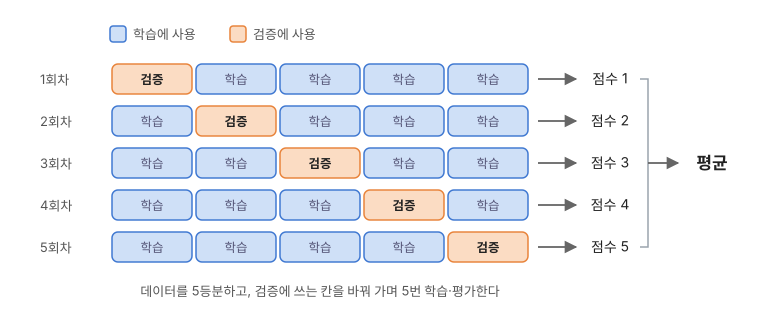

모든 데이터가 한 번씩 검증에 쓰이므로 평가가 안정적입니다. 그 대신 모델을 K번 학습해야 해서 비용이 K배 듭니다. 딥러닝은 한 번 학습하는 비용이 커서 데이터가 적을 때 주로 씁니다.

주의할 점은 매 겹마다 모델을 새로 초기화해야 한다는 것입니다. 이전 겹에서 학습한 가중치를 이어 쓰면 검증 조각을 이미 본 모델이 됩니다.

> 코드: [06_cross_validation.py](https://github.com/dev-jonghoonpark/introduction-to-pytorch/blob/master/ch05_mlp/06_cross_validation.py)

### 모델 구조와 가중치 확인

모델을 만든 뒤에는 구조와 파라미터를 확인할 수 있어야 합니다.

- `print(model)`: 층의 구성을 보여 줍니다.
- `model.named_parameters()`: 학습되는 가중치와 편향을 이름과 함께 돌려줍니다. 파라미터 수를 세거나 특정 층만 골라낼 때 씁니다.
- `model.state_dict()`: 파라미터 이름과 값을 담은 딕셔너리입니다. 모델을 저장하고 불러올 때 씁니다.

모델을 저장할 때는 모델 객체 전체가 아니라 `state_dict`를 저장하는 것이 표준입니다.

> 코드: [07_model_parameters.py](https://github.com/dev-jonghoonpark/introduction-to-pytorch/blob/master/ch05_mlp/07_model_parameters.py)

---

## 합성곱 신경망

### 이미지와 MLP의 한계

이미지는 [채널, 높이, 너비] 모양의 텐서입니다. 컬러 이미지는 채널이 3개(RGB), 흑백은 1개입니다.

MLP로 이미지를 처리하려면 픽셀을 한 줄로 펼쳐야 하는데, 두 가지 문제가 생깁니다.

- **공간 구조가 사라진다**: 위아래, 좌우로 이웃한 픽셀이라는 정보가 없어집니다. 물체가 몇 픽셀만 옆으로 옮겨져도 전혀 다른 입력이 됩니다.
- **파라미터가 폭증한다**: 224×224 컬러 이미지는 입력만 약 15만 개입니다. 은닉 노드가 1,000개면 첫 층에만 가중치가 1억 5천만 개 필요합니다.

### 합성곱 연산과 풀링 연산

합성곱 신경망(CNN)은 작은 필터(커널)를 이미지 위에서 옮겨 가며 같은 가중치를 반복해 적용합니다.

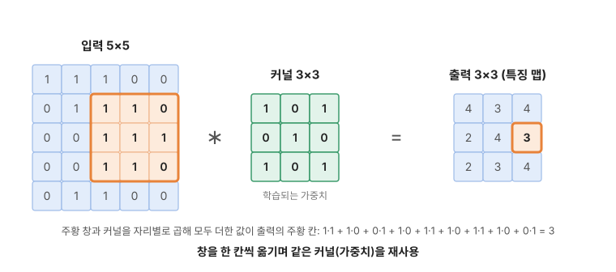

커널이 덮은 영역의 픽셀과 커널의 값을 곱해서 더한 것이 출력의 한 칸입니다. 이렇게 얻은 출력을 특징 맵(feature map)이라 부릅니다. 커널 하나가 윤곽선이나 색 변화 같은 패턴 하나를 검출하고, 그 커널의 값을 학습으로 찾습니다.

- **가중치 공유**: 위치마다 같은 커널을 쓰므로 파라미터 수가 이미지 크기와 무관합니다.
- **지역성**: 가까운 픽셀끼리만 묶어서 봅니다.
- **계층적 특징**: 앞쪽 층은 선과 모서리를, 뒤쪽 층은 그것들을 조합한 눈, 바퀴 같은 복잡한 형태를 봅니다.

출력 크기는 세 가지 값으로 정해집니다.

- **커널 크기(K)**: 한 번에 보는 영역의 크기
- **스트라이드(S)**: 커널을 한 번에 옮기는 칸 수
- **패딩(P)**: 입력 가장자리에 덧붙이는 칸 수. 출력이 줄어드는 것을 막습니다.

```
출력 크기 = ⌊(입력 크기 − K + 2P) / S⌋ + 1
```

풀링은 특징 맵의 크기를 줄이는 연산입니다. 영역마다 최댓값만 남기는 최대 풀링이 가장 흔합니다. 학습되는 가중치가 없고, 작은 위치 변화에 둔감해지는 효과가 있습니다.

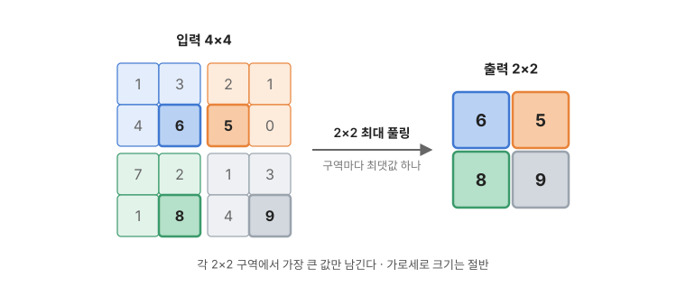

전형적인 CNN은 [합성곱 → 활성화 → 풀링]을 여러 번 반복해 특징을 뽑고, 마지막에 완전 연결 층으로 분류합니다.

> 코드: [01_conv_pool_basics.py](https://github.com/dev-jonghoonpark/introduction-to-pytorch/blob/master/ch06_cnn/01_conv_pool_basics.py)

### AlexNet

AlexNet은 2012년 이미지넷 대회(ILSVRC)에서 2위와 큰 격차로 우승하며 딥러닝 붐을 연 모델입니다. 합성곱 층 5개와 완전 연결 층 3개로 이루어져 있습니다. 구조 자체보다 이때 쓴 기법들이 이후의 표준이 됐습니다.

- **ReLU**: 시그모이드와 tanh 대신 써서 학습 속도를 크게 높였습니다.
- **드롭아웃**: 완전 연결 층에 적용해 과적합을 줄였습니다.
- **데이터 증식**: 이미지를 자르고 뒤집어 학습 데이터를 늘렸습니다.
- **GPU 학습**: GPU 두 장으로 큰 모델을 학습시켰습니다.

> 코드: [02_alexnet_cifar10.py](https://github.com/dev-jonghoonpark/introduction-to-pytorch/blob/master/ch06_cnn/02_alexnet_cifar10.py)

### ResNet

층을 깊게 쌓을수록 성능이 좋아질 것 같지만, 일정 깊이를 넘으면 오히려 학습 오차까지 나빠지는 현상이 있었습니다. 과적합이 아니라 깊은 망이 최적화하기 어렵기 때문입니다.

ResNet(2015)은 잔차 연결(skip connection)로 이 문제를 풀었습니다. 블록의 입력 `x`를 블록의 출력에 그대로 더해 줍니다.

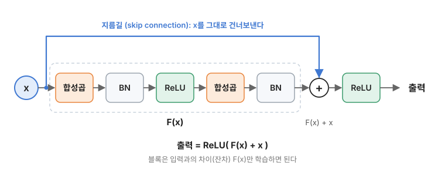

블록은 출력 전체가 아니라 입력과의 차이(잔차) `F(x)`만 학습하면 됩니다. 더 배울 것이 없는 층은 `F(x)`를 0으로 두면 입력을 그대로 통과시키므로, 층을 더 쌓아도 최소한 성능이 나빠지지 않습니다. 역전파에서도 기울기가 지름길을 타고 앞쪽 층까지 줄어들지 않고 전달됩니다.

이 구조 덕분에 152층짜리 모델을 학습할 수 있게 됐고, 잔차 연결은 이후 트랜스포머를 포함한 거의 모든 깊은 모델에 쓰입니다.

> 코드: [03_resnet_cifar10.py](https://github.com/dev-jonghoonpark/introduction-to-pytorch/blob/master/ch06_cnn/03_resnet_cifar10.py)

### 다양한 합성곱 신경망

| 모델         | 연도 | 핵심 아이디어                                               |
| ------------ | ---- | ----------------------------------------------------------- |
| VGG          | 2014 | 3×3 합성곱만 반복해서 깊게 쌓는다                           |
| GoogLeNet    | 2014 | 크기가 다른 커널을 나란히 적용하는 인셉션 모듈              |
| DenseNet     | 2017 | 각 층을 그 뒤의 모든 층과 연결한다                          |
| MobileNet    | 2017 | 합성곱을 채널별과 1×1로 나눠 연산량을 줄인다. 모바일용      |
| EfficientNet | 2019 | 깊이, 너비, 해상도를 균형 있게 함께 키운다                  |

2020년 이후에는 이미지를 조각으로 나눠 트랜스포머에 넣는 ViT(Vision Transformer)가 등장해 CNN과 함께 쓰이고 있습니다.

---

## 순환 신경망

### 순차 데이터와 순환 신경망

주가, 음성, 문장처럼 순서가 의미를 갖는 데이터가 순차 데이터입니다. MLP는 입력의 길이가 고정돼 있고 앞뒤 순서를 고려하지 못합니다.

순환 신경망(RNN)은 입력을 한 시점씩 차례로 받으면서, 이전까지의 내용을 요약한 은닉 상태(hidden state)를 다음 시점으로 넘겨줍니다.

```
h_t = tanh(W_x · x_t + W_h · h_(t−1) + b)
```

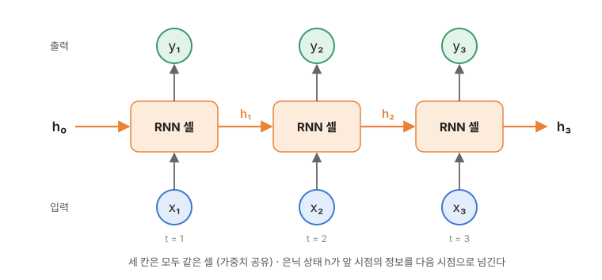

모든 시점에서 같은 가중치를 씁니다. 그래서 시퀀스 길이가 달라져도 같은 모델로 처리할 수 있습니다. 학습은 시간 축으로 펼친 망에 역전파를 적용하며, 이를 BPTT(backpropagation through time)라고 부릅니다.

입력과 출력의 개수에 따라 형태가 나뉩니다.

| 형태          | 입력 → 출력     | 예                          |
| ------------- | --------------- | --------------------------- |
| many-to-one   | 시퀀스 → 값 하나 | 감성 분류, 다음 날 주가 예측 |
| one-to-many   | 값 하나 → 시퀀스 | 이미지 설명 생성            |
| many-to-many  | 시퀀스 → 시퀀스  | 번역, 품사 태깅             |

파이토치의 `nn.RNN`, `nn.LSTM`, `nn.GRU`는 `batch_first=True`로 두면 입력을 [배치, 시퀀스 길이, 특징 수] 모양으로 받습니다. 기본값은 시퀀스 길이가 맨 앞에 오는 모양이라 헷갈리기 쉽습니다.

교재의 예제는 KOSPI 종가 예측입니다. 교재 코드는 값의 범위를 맞추는 스케일러를 전체 데이터에 맞추는데, 이는 3장에서 본 데이터 누수입니다. 저장소 코드에서는 학습 구간에만 맞추도록 고쳤습니다. 그 결과 테스트 구간의 오차가 교재 그림보다 커 보이는데, 테스트 구간(2020년 급락과 그 뒤 급등)이 학습 구간의 가격 범위를 벗어나기 때문입니다.

> 코드: [01_vanilla_rnn.py](https://github.com/dev-jonghoonpark/introduction-to-pytorch/blob/master/ch07_rnn/01_vanilla_rnn.py)

### LSTM과 GRU

기본 RNN은 시퀀스가 길어지면 앞쪽 정보를 잊습니다. 역전파가 시점마다 같은 가중치를 반복해 곱하기 때문에 기울기가 0으로 사라지거나 폭발합니다. 이를 장기 의존성 문제라고 합니다.

LSTM(Long Short-Term Memory)은 은닉 상태와 별도로 셀 상태(cell state)를 둡니다. 셀 상태는 덧셈 위주로 갱신되기 때문에 정보와 기울기가 먼 시점까지 잘 전달됩니다. 셀 상태에 무엇을 남기고 버릴지는 게이트 세 개가 정합니다.

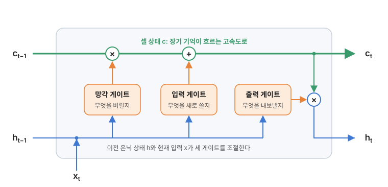

- **망각 게이트**: 이전 셀 상태에서 무엇을 버릴지 정합니다.
- **입력 게이트**: 새 정보 중 무엇을 셀 상태에 쓸지 정합니다.
- **출력 게이트**: 셀 상태 중 무엇을 은닉 상태로 내보낼지 정합니다.

게이트는 시그모이드로 0과 1 사이의 값을 내서 정보를 얼마나 통과시킬지 조절하고, 그 값 자체도 학습됩니다.

GRU(Gated Recurrent Unit)는 LSTM을 단순화한 구조입니다. 셀 상태를 따로 두지 않고 게이트도 두 개(리셋, 업데이트)로 줄였습니다. 파라미터가 적어 학습이 빠르고 성능은 LSTM과 비슷한 경우가 많습니다.

| 구분        | 기본 RNN | LSTM               | GRU            |
| ----------- | -------- | ------------------ | -------------- |
| 게이트 수   | 0        | 3                  | 2              |
| 상태        | 은닉 상태 | 은닉 상태, 셀 상태 | 은닉 상태      |
| 장기 의존성 | 약함     | 강함               | 강함           |
| 파라미터 수 | 적음     | 많음               | 중간           |

> 코드: [02_lstm.py](https://github.com/dev-jonghoonpark/introduction-to-pytorch/blob/master/ch07_rnn/02_lstm.py), [03_gru.py](https://github.com/dev-jonghoonpark/introduction-to-pytorch/blob/master/ch07_rnn/03_gru.py)

### Bi-LSTM

일반 RNN은 과거에서 현재 방향으로만 읽습니다. 그런데 문장 중간의 단어를 이해하려면 뒤에 오는 단어도 봐야 할 때가 많습니다.

양방향 LSTM(Bi-LSTM)은 LSTM 두 개를 씁니다. 하나는 앞에서 뒤로, 다른 하나는 뒤에서 앞으로 읽고, 각 시점에서 두 은닉 상태를 이어 붙입니다.

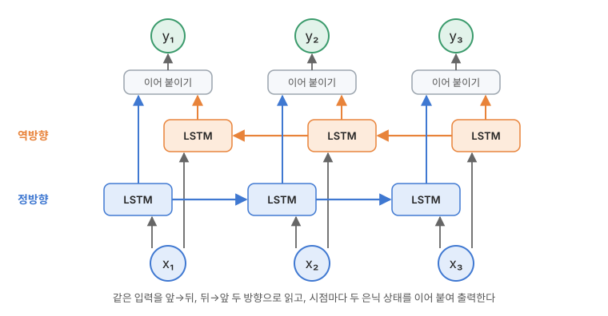

출력 차원이 은닉 크기의 두 배가 되므로 뒤에 붙는 층의 입력 크기를 맞춰야 합니다. 시퀀스 전체가 주어져야 쓸 수 있어서, 미래 값을 모르는 실시간 예측에는 맞지 않습니다.

> 코드: [04_bi_lstm.py](https://github.com/dev-jonghoonpark/introduction-to-pytorch/blob/master/ch07_rnn/04_bi_lstm.py)

---

## 비지도 학습

### 비지도 학습이란

비지도 학습은 정답 없이 데이터만으로 구조를 찾는 방법입니다. 라벨을 붙이는 비용이 들지 않아 훨씬 많은 데이터를 쓸 수 있습니다. 하는 일은 크게 세 가지입니다.

- **군집화**: 비슷한 데이터끼리 묶습니다. (K-평균)
- **표현 학습, 차원 축소**: 데이터를 더 작고 유용한 벡터로 요약합니다. (오토인코더)
- **생성**: 학습 데이터와 닮은 새 데이터를 만듭니다. (GAN)

### K-평균 알고리즘

K-평균은 데이터를 K개의 군집으로 나누는 알고리즘입니다.

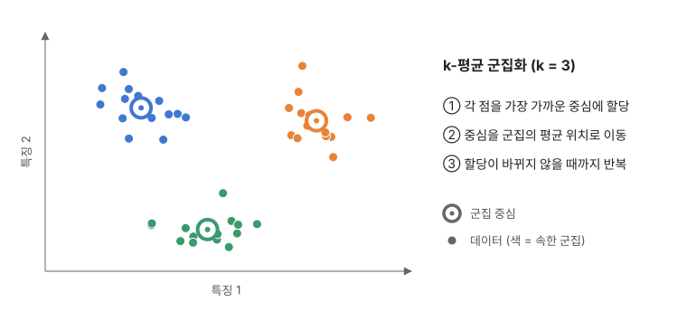

1. 중심 K개를 임의로 정합니다.
2. 각 데이터를 가장 가까운 중심의 군집에 할당합니다.
3. 각 군집의 중심을 그 군집에 속한 데이터의 평균으로 옮깁니다.
4. 중심이 더 움직이지 않을 때까지 2와 3을 반복합니다.

단순하고 빠르지만 한계가 있습니다. K를 미리 정해야 하고, 초기 중심에 따라 결과가 달라지며, 거리 기반이라 둥근 모양이 아닌 군집은 잘 나누지 못합니다. 이미지처럼 차원이 높은 데이터는 픽셀 간 거리가 의미를 갖기 어려워 그대로 적용하면 잘 되지 않습니다.

> 코드: [01_kmeans.py](https://github.com/dev-jonghoonpark/introduction-to-pytorch/blob/master/ch08_unsupervised/01_kmeans.py)

### 오토인코더

오토인코더는 입력을 그대로 복원하도록 학습하는 신경망입니다. 정답이 입력 자신이므로 라벨이 필요 없습니다.

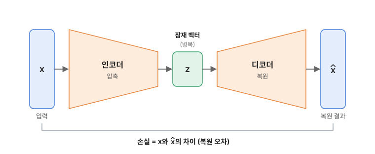

- **인코더**: 입력을 더 작은 잠재 벡터(latent vector)로 압축합니다.
- **디코더**: 잠재 벡터에서 원래 입력을 복원합니다.

가운데가 좁은 병목 구조라 입력을 그대로 베낄 수 없고, 복원에 꼭 필요한 정보만 잠재 벡터에 남기게 됩니다. 학습이 끝난 인코더는 특징 추출기로 쓸 수 있습니다.

| 종류                 | 방식                                         | 효과                                       |
| -------------------- | -------------------------------------------- | ------------------------------------------ |
| 스택 오토인코더      | 완전 연결 층을 여러 개 쌓는다                | 기본형                                     |
| 디노이징 오토인코더  | 입력에 잡음을 넣고 깨끗한 원본을 복원시킨다  | 잡음에 강한 특징을 배운다                  |
| 합성곱 오토인코더    | 합성곱 층과 전치 합성곱 층을 쓴다            | 이미지의 공간 구조를 유지한다              |

> 코드: [02_stacked_autoencoder.py](https://github.com/dev-jonghoonpark/introduction-to-pytorch/blob/master/ch08_unsupervised/02_stacked_autoencoder.py), [03_denoising_autoencoder.py](https://github.com/dev-jonghoonpark/introduction-to-pytorch/blob/master/ch08_unsupervised/03_denoising_autoencoder.py), [04_conv_autoencoder.py](https://github.com/dev-jonghoonpark/introduction-to-pytorch/blob/master/ch08_unsupervised/04_conv_autoencoder.py)

### 생성적 적대 신경망

생성적 적대 신경망(GAN)은 두 신경망을 경쟁시켜 진짜 같은 데이터를 만들어 냅니다.

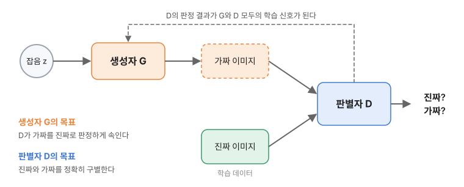

- **생성자(Generator)**: 무작위 잡음을 받아 가짜 데이터를 만듭니다. 판별자를 속이는 것이 목표입니다.
- **판별자(Discriminator)**: 진짜 데이터와 생성자가 만든 가짜를 구별합니다.

위조지폐범과 경찰의 관계에 비유합니다. 판별자가 잘 구별할수록 생성자는 더 정교하게 만들어야 하고, 이 경쟁이 반복되면서 생성자의 결과물이 진짜에 가까워집니다. 학습은 판별자와 생성자를 번갈아 한 걸음씩 갱신합니다.

GAN은 학습이 까다롭습니다. 한쪽이 지나치게 강해지면 다른 쪽이 배우지 못하고, 생성자가 판별자를 속이기 쉬운 몇 가지 결과만 반복해서 만드는 모드 붕괴(mode collapse)가 생기기도 합니다. 손실 값이 내려간다고 결과물이 좋아지는 것도 아니어서, 생성된 이미지를 직접 봐야 합니다.

DCGAN(Deep Convolutional GAN)은 GAN에 합성곱 구조를 적용해 학습을 안정시킨 모델입니다. 다음 지침을 제시했습니다.

- 풀링 대신 스트라이드가 있는 합성곱(생성자는 전치 합성곱)을 씁니다.
- 생성자와 판별자 모두 배치 정규화를 씁니다.
- 완전 연결 은닉층을 없앱니다.
- 생성자는 ReLU(출력층은 tanh), 판별자는 LeakyReLU를 씁니다.

FashionMNIST로 직접 돌려 보면 차이가 뚜렷합니다. 완전 연결층만 쓴 Vanilla GAN은 30 에폭에서 옷 윤곽이 나오지만 점이 흩어져 있고, 교재와 같은 151 에폭(CPU 44분)을 돌려도 종류만 늘 뿐 점은 그대로 남습니다. 합성곱으로 바꾼 DCGAN은 5 에폭(갱신 횟수로는 30분의 1)만에 면이 매끈한 그림을 냅니다. 완전 연결층은 픽셀을 하나씩 따로 정하지만, 전치 합성곱은 이웃한 픽셀을 같은 필터로 함께 그리기 때문입니다.

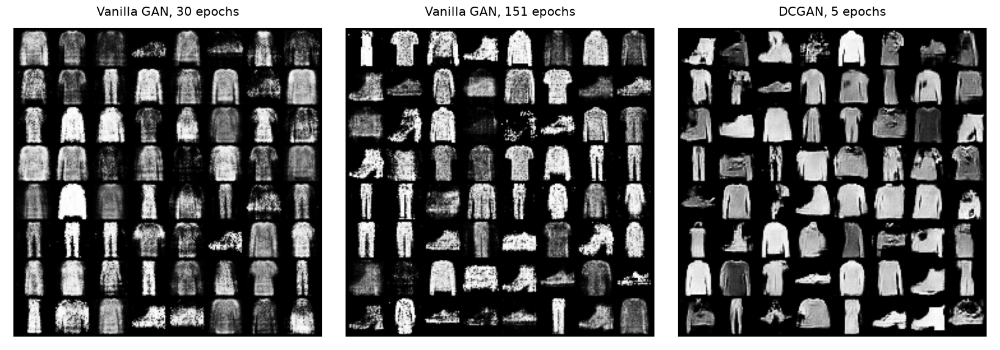

교재의 DCGAN 구조는 배치 정규화가 없어서, 20 에폭(CPU 5시간)을 돌려도 회색 화면에서 벗어나지 못했습니다. 위 지침대로 배치 정규화를 넣고 Adam의 β1을 0.5로 낮춘 뒤에야 위 결과가 나왔습니다.

> 코드: [05_gan.py](https://github.com/dev-jonghoonpark/introduction-to-pytorch/blob/master/ch08_unsupervised/05_gan.py), [06_dcgan.py](https://github.com/dev-jonghoonpark/introduction-to-pytorch/blob/master/ch08_unsupervised/06_dcgan.py)
>
> 단계별 해설: [GAN 한 단계씩](https://dev-jonghoonpark.github.io/introduction-to-pytorch/gan/)

### 이미지 스타일 변이

스타일 변이(style transfer)는 한 이미지의 내용에 다른 이미지의 화풍을 입히는 기법입니다. 사진을 고흐 그림처럼 바꾸는 식입니다.

여기서는 모델을 학습시키지 않습니다. 사전 학습된 CNN(VGG)의 가중치는 고정해 두고, 결과 이미지의 픽셀 값을 직접 최적화합니다.

- **내용 손실**: 결과 이미지와 내용 이미지를 VGG에 넣었을 때 깊은 층의 특징 맵이 비슷해지도록 합니다. 깊은 층은 물체의 배치와 형태를 담습니다.
- **스타일 손실**: 결과 이미지와 스타일 이미지의 그람 행렬(Gram matrix)이 비슷해지도록 합니다. 그람 행렬은 특징 맵 채널 사이의 상관관계로, 위치 정보는 버리고 질감과 색 조합만 남깁니다.

두 손실의 가중합을 줄이는 방향으로 이미지를 고쳐 나갑니다. 가중치 비율로 내용과 스타일 중 어느 쪽을 더 살릴지 조절합니다.

> 코드: [07_style_transfer.py](https://github.com/dev-jonghoonpark/introduction-to-pytorch/blob/master/ch08_unsupervised/07_style_transfer.py)

### 깊은 K-평균 알고리즘

이미지는 픽셀 거리로 군집화하기 어려우니, 오토인코더로 잠재 벡터를 뽑고 그 공간에서 군집화하는 방법을 생각할 수 있습니다. 그런데 복원만 잘하도록 학습한 잠재 공간이 군집화하기에도 좋다는 보장은 없습니다. 저장소 코드로 MNIST에서 확인해 보니 잠재 공간 K-평균의 정확도(0.49)가 픽셀 K-평균(0.55)보다 높지 않았습니다. 깊은 K-평균(Deep k-Means)은 그래서 오토인코더와 군집화를 따로 하지 않고 함께 학습시킵니다.

손실은 두 부분으로 이루어집니다.

- **복원 손실**: 오토인코더가 입력을 잘 복원하도록 합니다.
- **군집 손실**: 잠재 벡터가 자기 군집의 중심에 가까워지도록 합니다.

이렇게 하면 인코더가 군집화하기 좋은 잠재 공간을 만들도록 학습됩니다. 라벨 없이 학습하므로 군집 번호와 실제 클래스가 대응되지 않아서, 평가할 때는 군집과 클래스를 가장 잘 맞는 쌍으로 짝지은 뒤(헝가리안 알고리즘) 정확도를 잽니다.

> 코드: [08_deep_kmeans.py](https://github.com/dev-jonghoonpark/introduction-to-pytorch/blob/master/ch08_unsupervised/08_deep_kmeans.py)
>
> 단계별 해설: [깊은 K-평균 한 단계씩](https://dev-jonghoonpark.github.io/introduction-to-pytorch/deep-kmeans/)

---

## 성능 개선

### 과적합

과적합(overfitting)은 모델이 학습 데이터를 외워서 학습 성능은 좋은데 새 데이터에서는 성능이 나쁜 상태입니다. 모델이 데이터에 비해 지나치게 크거나 데이터가 적을 때 생깁니다.

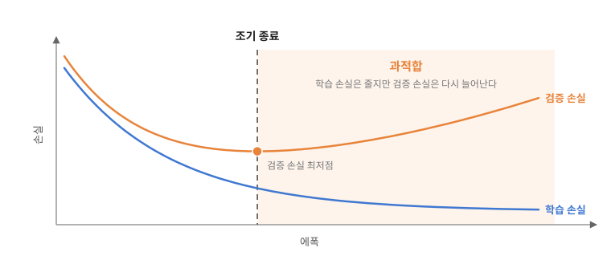

과적합을 줄이는 기법을 통틀어 정규화(regularization)라고 부릅니다.

#### 데이터 증식

학습 이미지를 무작위로 자르고, 뒤집고, 회전하고, 색을 바꿔서 매번 조금씩 다른 이미지를 보여 줍니다. 데이터를 새로 모으지 않고도 다양성을 늘리는 방법입니다. 학습 세트에만 적용하고 검증과 평가 세트에는 적용하지 않습니다. 라벨이 바뀌는 변형은 쓰면 안 됩니다. 숫자 6을 뒤집으면 9가 되는 경우가 그렇습니다.

#### 조기 종료

검증 손실이 더 줄지 않고 일정 에폭 동안 개선이 없으면 학습을 멈춥니다. 검증 손실이 가장 낮았던 시점의 가중치를 저장해 뒀다가 그것을 최종 모델로 씁니다.

#### L2 정규화

손실에 가중치 크기의 제곱합을 더합니다. 가중치가 커지는 것을 억제해서 모델이 특정 입력에 과하게 반응하지 않게 합니다. 파이토치에서는 옵티마이저의 `weight_decay` 값으로 줍니다.

#### 드롭아웃

학습할 때 노드를 무작위로 꺼서 출력을 0으로 만듭니다. 특정 노드에 의존하지 못하므로 여러 노드가 고르게 역할을 나눠 갖습니다. 평가할 때는 모든 노드를 씁니다.

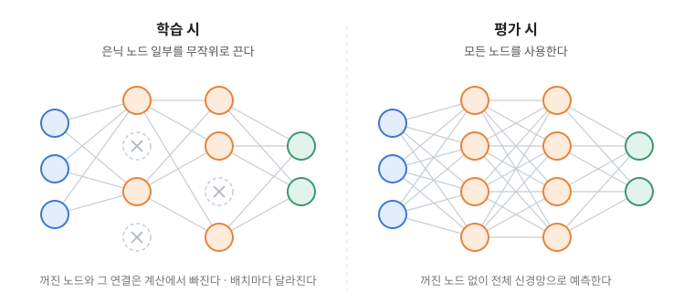

#### 배치 정규화

각 층의 입력을 미니배치 단위로 평균 0, 분산 1이 되게 맞춘 뒤, 학습되는 값으로 크기와 위치를 다시 조정합니다. 학습이 빠르고 안정적이 되며 약한 정규화 효과도 있습니다. 평가할 때는 배치의 통계가 아니라 학습 중에 누적해 둔 평균과 분산을 씁니다.

드롭아웃과 배치 정규화는 학습과 평가에서 동작이 다릅니다. 그래서 `model.train()`과 `model.eval()`로 모드를 반드시 바꿔 줘야 합니다. 평가할 때 `model.eval()`을 빠뜨리는 것이 흔한 실수입니다.

#### 교란 라벨

교란 라벨(DisturbLabel)은 매 반복마다 일부 샘플의 라벨을 무작위 라벨로 바꿔서 학습합니다. 일부러 틀린 정답을 조금 섞어 모델이 정답을 지나치게 확신하지 못하게 합니다. 입력이나 가중치가 아니라 손실 쪽에 잡음을 넣는 정규화입니다.

#### 교란 값

교란 값(DisturbValue)은 같은 아이디어를 회귀에 적용한 것입니다. 일부 샘플의 목표값에 잡음을 더해 학습합니다.

정규화 기법이 언제나 성능을 올려 주는 것은 아닙니다. 저장소 코드로 짧게 학습해 본 결과 교란 라벨은 기본 모델보다 정확도가 낮았고(57.5% 대 61.2%), 교란 값은 차이가 시드 편차보다 작았습니다. 과적합이 심하지 않은 상황에서는 정규화가 학습을 늦추기만 합니다.

#### 라벨 스무딩

정답 라벨을 [0, 0, 1]처럼 단정하지 않고 [0.05, 0.05, 0.9]처럼 조금 누그러뜨립니다. 정답 클래스의 확률을 1로 만들려고 출력값을 끝없이 키우는 것을 막아 줍니다. 지금은 `nn.CrossEntropyLoss(label_smoothing=0.1)`처럼 인자 하나로 쓸 수 있습니다.

> 코드: [01_regularization.py](https://github.com/dev-jonghoonpark/introduction-to-pytorch/blob/master/ch09_improvement/01_regularization.py), [02_early_stopping.py](https://github.com/dev-jonghoonpark/introduction-to-pytorch/blob/master/ch09_improvement/02_early_stopping.py), [03_disturb_label.py](https://github.com/dev-jonghoonpark/introduction-to-pytorch/blob/master/ch09_improvement/03_disturb_label.py), [04_disturb_value.py](https://github.com/dev-jonghoonpark/introduction-to-pytorch/blob/master/ch09_improvement/04_disturb_value.py), [05_label_smoothing.py](https://github.com/dev-jonghoonpark/introduction-to-pytorch/blob/master/ch09_improvement/05_label_smoothing.py)

### 데이터 불균형

클래스별 데이터 수가 크게 다르면 모델이 다수 클래스만 맞히는 쪽으로 학습됩니다. 정상이 99%, 불량이 1%인 데이터에서는 전부 정상이라고 답해도 정확도가 99%입니다.

- **가중 무작위 샘플링**: 소수 클래스의 샘플이 더 자주 뽑히도록 확률을 줘서, 배치 안의 클래스 비율을 비슷하게 맞춥니다. (`WeightedRandomSampler`)
- **가중 손실 함수**: 소수 클래스를 틀렸을 때 손실을 더 크게 매깁니다. (`nn.CrossEntropyLoss(weight=...)`)

불균형 데이터에서는 정확도만 보면 안 됩니다. 혼동 행렬(confusion matrix)은 실제 클래스와 예측 클래스의 조합별 개수를 표로 나타낸 것으로, 어느 클래스를 어느 클래스로 헷갈리는지 보여 줍니다. 여기서 클래스별 지표를 구합니다.

- **정밀도(precision)**: 그 클래스라고 예측한 것 중 실제로 맞은 비율
- **재현율(recall)**: 실제 그 클래스인 것 중 찾아낸 비율
- **F1 점수**: 정밀도와 재현율의 조화 평균

> 코드: [06_data_imbalance.py](https://github.com/dev-jonghoonpark/introduction-to-pytorch/blob/master/ch09_improvement/06_data_imbalance.py)

### 전이 학습

전이 학습(transfer learning)은 큰 데이터로 미리 학습된 모델을 가져와 내 문제에 맞게 조금 더 학습시키는 방법입니다. 이미지넷으로 학습된 모델의 앞쪽 층은 선, 질감, 형태 같은 일반적인 특징을 이미 알고 있어서 다른 이미지 문제에도 쓸 수 있습니다. 데이터가 적어도 좋은 성능을 내고 학습 시간도 짧습니다.

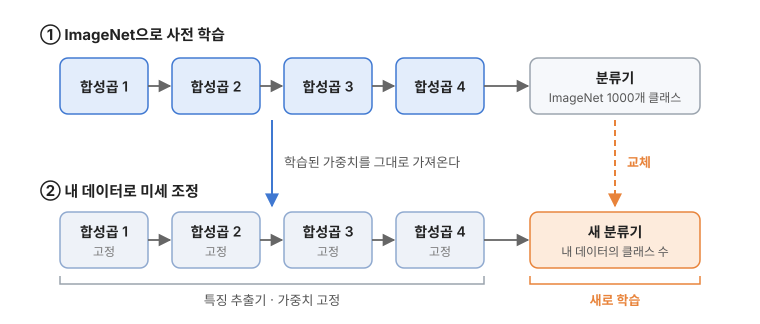

절차는 간단합니다. 사전 학습 모델을 불러와서 마지막 분류 층을 내 클래스 수에 맞는 새 층으로 바꾸고 학습합니다.

모델 프리징(freezing)은 일부 층의 가중치를 고정해 학습되지 않게 하는 것입니다. `requires_grad`를 `False`로 두면 그 파라미터는 기울기를 계산하지 않습니다.

| 방식                     | 학습 대상        | 맞는 상황                                  |
| ------------------------ | ---------------- | ------------------------------------------ |
| 특징 추출 (전부 프리징)  | 새 분류 층만     | 데이터가 적고 원래 데이터와 비슷할 때      |
| 미세 조정 (fine-tuning)  | 전체 또는 뒤쪽 층 | 데이터가 충분하거나 원래 데이터와 다를 때  |

미세 조정할 때는 학습률을 작게 잡아서 사전 학습된 가중치가 크게 망가지지 않게 합니다.

> 코드: [07_transfer_learning.py](https://github.com/dev-jonghoonpark/introduction-to-pytorch/blob/master/ch09_improvement/07_transfer_learning.py), [08_model_freezing.py](https://github.com/dev-jonghoonpark/introduction-to-pytorch/blob/master/ch09_improvement/08_model_freezing.py)

### 준지도 학습

준지도 학습(semi-supervised learning)은 라벨이 있는 소량의 데이터와 라벨이 없는 대량의 데이터를 함께 씁니다.

의사 라벨링(pseudo labeling)은 그중 가장 단순한 방법입니다.

1. 라벨이 있는 데이터로 모델을 학습합니다.
2. 그 모델로 라벨이 없는 데이터를 예측합니다.
3. 예측을 정답처럼 붙여서(의사 라벨) 학습 데이터에 추가합니다.
4. 합친 데이터로 다시 학습합니다.

모델이 틀린 예측을 정답으로 믿고 학습하면 오류가 굳어집니다. 그래서 예측 확률이 기준값보다 높은 샘플만 쓰거나, 의사 라벨 손실의 비중을 처음에는 작게 두고 서서히 높입니다.

> 코드: [09_pseudo_labeling.py](https://github.com/dev-jonghoonpark/introduction-to-pytorch/blob/master/ch09_improvement/09_pseudo_labeling.py)
>
> 단계별 해설: [의사 라벨링 한 단계씩](https://dev-jonghoonpark.github.io/introduction-to-pytorch/pseudo-labeling/)

---

## 시각화

### 설명 가능한 인공지능

신경망은 왜 그런 답을 냈는지 알기 어렵습니다. 설명 가능한 인공지능(XAI)은 모델의 판단 근거를 사람이 이해할 수 있게 보여 주는 기법들을 가리킵니다. 모델이 엉뚱한 단서(배경, 워터마크)로 답을 맞히고 있지 않은지 확인하는 데도 씁니다.

CAM(Class Activation Map)은 CNN이 이미지의 어느 영역을 보고 그 클래스로 판단했는지를 히트맵으로 보여 줍니다.

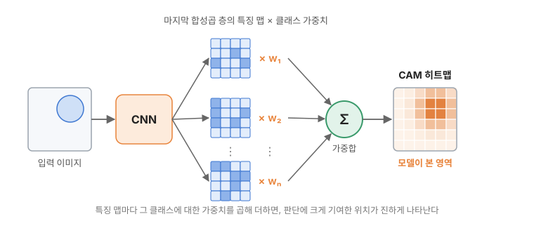

마지막 합성곱 층의 특징 맵들은 각각 어떤 패턴이 어느 위치에 있는지를 담고 있습니다. 여기에 분류 층에서 해당 클래스로 이어지는 가중치를 곱해 더하면, 그 클래스의 판단에 크게 기여한 위치가 밝게 나타납니다.

CAM은 마지막 합성곱 층 뒤에 전역 평균 풀링(GAP)과 완전 연결 층 하나가 오는 구조에서만 쓸 수 있습니다. 가중치 대신 기울기를 써서 구조 제약을 없앤 Grad-CAM이 더 널리 쓰입니다.

> 코드: [01_cam.py](https://github.com/dev-jonghoonpark/introduction-to-pytorch/blob/master/ch10_visualization/01_cam.py)

### 차원 축소 기법

모델이 뽑은 특징 벡터는 수백 차원이라 그대로 볼 수 없습니다. 2차원이나 3차원으로 줄여서 그리면 같은 클래스끼리 잘 모여 있는지 확인할 수 있습니다.

| 구분     | PCA (주성분 분석)                        | t-SNE                                              |
| -------- | ---------------------------------------- | -------------------------------------------------- |
| 방식     | 분산이 가장 큰 방향을 찾아 그 축으로 투영 | 가까운 점끼리 가깝게 유지되도록 배치               |
| 성질     | 선형                                     | 비선형                                             |
| 보존     | 전체적인 구조                            | 이웃 관계(국소 구조)                               |
| 속도     | 빠르다                                   | 느리다                                             |
| 재현성   | 항상 같은 결과                           | 실행할 때마다 달라질 수 있다                       |
| 새 데이터 | 같은 변환을 적용할 수 있다               | 처음부터 다시 계산해야 한다                        |

t-SNE는 군집이 뚜렷하게 보여서 시각화에 많이 쓰지만 해석에 주의해야 합니다. 군집 사이의 거리와 군집의 크기는 의미가 없고, perplexity 값에 따라 그림이 크게 달라집니다. PCA는 시각화 외에 전처리용 차원 축소에도 쓰입니다.

> 코드: [02_tsne_pca.py](https://github.com/dev-jonghoonpark/introduction-to-pytorch/blob/master/ch10_visualization/02_tsne_pca.py)

---

## 메타 학습

### 메타 러닝과 퓨샷 러닝

사람은 처음 보는 동물도 사진 몇 장이면 구별합니다. 딥러닝 모델은 보통 클래스마다 수천 장이 필요합니다.

퓨샷 러닝(few-shot learning)은 클래스당 예시 몇 개만으로 새 과제를 푸는 문제입니다. N개 클래스에 클래스당 K개의 예시가 주어지면 N-way K-shot이라고 부릅니다. 주어진 예시를 서포트 세트(support set), 맞혀야 할 문제를 쿼리 세트(query set)라고 합니다.

메타 러닝(meta learning)은 이를 위한 접근으로, "학습하는 방법을 학습"합니다. 과제 하나를 잘 푸는 것이 목표가 아닙니다. 수많은 과제를 겪으면서 새 과제에 빨리 적응하는 능력을 기릅니다. 학습 단위가 데이터 한 건이 아니라 과제 하나입니다.

### MAML

MAML(Model-Agnostic Meta-Learning)은 "어느 과제로든 몇 걸음만 가면 되는 좋은 초기 가중치"를 찾습니다.

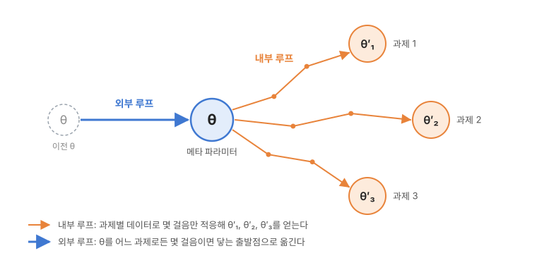

학습은 이중 루프로 이루어집니다.

- **내부 루프 (적응)**: 현재 초기 가중치 θ에서 출발해 과제 하나의 서포트 세트로 경사하강을 몇 걸음 진행합니다. 과제에 적응한 가중치 θ′를 얻습니다.
- **외부 루프 (메타 갱신)**: θ′로 그 과제의 쿼리 세트를 풀어 손실을 구합니다. 여러 과제의 손실을 모아서 θ′가 아니라 출발점 θ를 갱신합니다.

외부 루프의 기울기는 "θ를 어떻게 바꾸면 적응한 뒤의 성능이 좋아지는가"입니다. 내부 루프의 경사하강 과정을 거슬러 미분해야 하므로 2차 미분이 필요하고 연산이 무겁습니다. 2차 항을 무시하는 1차 근사(FOMAML)가 훨씬 빠르면서 성능도 크게 떨어지지 않아 자주 쓰입니다.

모델 구조에 제약이 없다는 것이 이름의 "model-agnostic"입니다. 경사하강법으로 학습하는 모델이면 회귀, 분류, 강화 학습 어디에나 쓸 수 있습니다. 교재는 사인 함수 회귀와 이미지 분류 두 예제를 다룹니다.

> 코드: [01_maml_regression.py](https://github.com/dev-jonghoonpark/introduction-to-pytorch/blob/master/ch11_meta_learning/01_maml_regression.py), [02_maml_classification.py](https://github.com/dev-jonghoonpark/introduction-to-pytorch/blob/master/ch11_meta_learning/02_maml_classification.py)
>
> 단계별 해설: [MAML 한 단계씩](https://dev-jonghoonpark.github.io/introduction-to-pytorch/maml/)

---

## 과학적 계산

### 유한차분법

물리 현상은 대부분 미분방정식으로 기술됩니다. 해를 식으로 구할 수 없는 경우가 많아서 컴퓨터로 근사해를 계산합니다.

유한차분법(FDM)은 공간과 시간을 격자로 나누고, 미분을 이웃한 격자점 값의 차이로 바꿔서 풉니다.

```
du/dx ≈ (u(x + h) − u(x − h)) / 2h
```

미분방정식이 격자점 값들 사이의 연립방정식으로 바뀌어 컴퓨터로 풀 수 있게 됩니다. 격자를 촘촘하게 할수록 정확하지만 계산량이 늘고, 차원이 높아지면 격자점 수가 급격히 불어납니다.

> 코드: [01_finite_difference.py](https://github.com/dev-jonghoonpark/introduction-to-pytorch/blob/master/ch12_scientific/01_finite_difference.py)

### 은닉 유체 메카니즘

신경망으로 미분방정식을 푸는 방법이 PINN(Physics-Informed Neural Network)입니다. 신경망이 좌표를 입력받아 그 지점의 해를 출력하게 하고, 그 출력이 물리 법칙을 만족하도록 손실을 구성합니다.

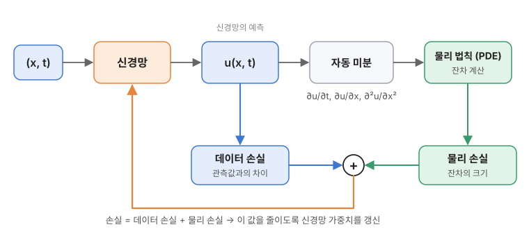

- **데이터 손실**: 관측값이 있는 지점에서 신경망의 출력이 관측값과 같아지게 합니다.
- **물리 손실**: 신경망의 출력을 입력 좌표로 자동 미분해서 미분방정식에 대입합니다. 방정식이 만족되면 0이 되는 값(잔차)을 0에 가깝게 만듭니다.

4장에서 본 자동 미분이 여기서 다시 쓰입니다. 가중치가 아니라 입력에 대한 미분을 구한다는 점만 다릅니다. 격자가 필요 없고, 관측 데이터가 적거나 잡음이 있어도 물리 법칙이 빈 곳을 채워 준다는 것이 장점입니다.

은닉 유체 메카니즘(Hidden Fluid Mechanics, HFM)은 PINN을 유체에 적용한 연구입니다. 유체에 섞인 염료나 연기의 농도는 영상으로 관측할 수 있지만 속도와 압력은 직접 재기 어렵습니다. HFM은 농도 관측값만으로 속도장과 압력장을 추정합니다.

- **입력**: 시간과 위치 (t, x, y)
- **출력**: 농도 c, 속도 u와 v, 압력 p
- **데이터 손실**: 농도 c만 관측값과 비교합니다.
- **물리 손실**: 출력들이 나비에-스토크스 방정식과 농도의 수송 방정식을 만족하도록 합니다.

속도와 압력은 정답 데이터가 전혀 없습니다. 관측된 농도의 변화를 설명하려면 물리 법칙상 속도와 압력이 어떤 값이어야 하는지를 신경망이 찾아내는 구조입니다. 교재는 원기둥 뒤를 흐르는 2차원 유동 데이터를 예제로 씁니다.

다만 학습에 시간이 오래 걸립니다. 교재는 40시간 학습을 전제로 합니다. 저장소 코드를 CPU에서 300회(약 5분) 돌려 보면 손실은 0.81에서 0.006으로 줄고 농도 오차도 줄지만, 속도와 압력의 오차는 학습 전과 같습니다. 3,000회(약 90분)까지 늘려도 마찬가지였습니다. 신경망이 "아무것도 흐르지 않는다"는 답에 머물러 있고, 이 답도 방정식은 만족하기 때문입니다. 손실이 줄었다고 숨은 값이 맞춰진 것은 아닙니다.

> 코드: [ch12_scientific/hfm](https://github.com/dev-jonghoonpark/introduction-to-pytorch/tree/master/ch12_scientific/hfm)
>
> 단계별 해설: [은닉 유체 메카니즘 한 단계씩](https://dev-jonghoonpark.github.io/introduction-to-pytorch/hfm/)

---

## 전체 회고

- 한 바퀴 돌고 남은 것:
- 더 파볼 주제:
